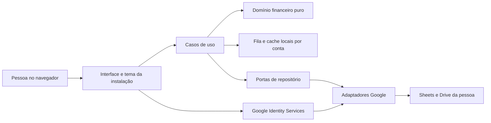

# Atualização 4.7 — Base Anderson com Google — 12/11/2026

Esta atualização prevalece sobre trechos anteriores que descrevem OAuth, Sheets, hospedagem ou aprovação como pendentes. A instalação Anderson foi publicada em site privado e autorizada pelo proprietário a usar uma planilha privada do Google. Login, gravação, leitura, confirmação remota e desfazer foram verificados com dados sintéticos; o teste foi desfeito e não entra nos totais.

A base atual está em HTML/CSS/JavaScript sem dependências npm de runtime, com núcleo financeiro compartilhado, adaptador local, histórico append-only, cliente Google, documentação e testes em `src/`, `shared/`, `docs/` e `tests/`. A integração usa Google Identity Services e `drive.file`, mantém tokens somente em memória e não usa client secret no frontend. O projeto Google está em modo de teste e liberado somente para Anderson. A hospedagem permanece privada pelo ChatGPT; essa autenticação é separada do Google.

Limites atuais: usar um aparelho por vez; sem mesclagem automática simultânea; edições manuais na aba `Lançamentos` não são importadas; mantenha backup e espere “Confirmado no Google”. A planilha guarda dados privados do usuário e não faz parte deste repositório.

Para outra pessoa, crie instalação, client ID, origem, conta Google e planilha próprios. Use `shared/google-config.example.js` e `docs/REUSO_INSTALACOES.md`; nunca reutilize o `shared/google-config.js` Anderson. Não tornar este repositório público com a configuração específica presente.

# Atualização 4.6 — Entrega local verificada — 11/11/2026

Esta seção prevalece sobre planos históricos que tratam a aprovação visual como pendente. Anderson e Luana aprovaram os visuais produzidos no Claude; eles foram preservados. O usuário escolheu uso local primeiro e não tem Client ID Google. Portanto OAuth/Sheets/Drive, publicação e PWA continuam pendentes, não concluídos nem simulados como autenticação real.

## Instalações isoladas
- Luana: `/home/anderson/caixa-rapido-luana-final`, endereço `http://localhost:5199/`.
- Anderson: `/home/anderson/caixa-rapido-anderson-final`, endereço `http://localhost:5200/`.
- Cada pasta tem `INICIAR.sh`, `LEIA_PRIMEIRO_LOCAL.md`, `src/`, `shared/`, `tests/`, `dist/`, `server.cjs`, `package.json`. Não alterar as pastas antigas nem os backups.
- Implementação HTML/CSS/JS sem dependências de execução externas; não migrar para React somente por preferência de ferramenta. Núcleo compartilhado com adaptadores para os dois visuais.
- Dados pessoais vazios por padrão; demonstração em chave separada, instalação separada e origens/portas distintas. Os dados ficam no navegador, não na pasta do projeto.

## Critérios concluídos nesta entrega local
- Parser brasileiro com sinais explícitos prioritários, conferência, validação de valores e datas, categorias e palavras-chave.
- Cálculo em centavos, edição, desfazer/restaurar, orçamentos por mês, avisos de limite, previsões separadas de realizados.
- Relatórios, CSV protegido contra fórmulas e backup JSON versionado por instalação com validação antes da restauração.
- Salvamento local com detecção de conflito entre abas, aviso de falha e de alterações não salvas.
- Assinatura Rudeboybrdev discreta em verde Matrix nos dois; restante do tema segue cada visual aprovado.
- Builds e testes passaram. Luana: 30 verificações herdadas, 10 grupos do núcleo e 5 verificações de armazenamento. Anderson: 6 verificações do adaptador, os mesmos 10 grupos e 5 de armazenamento.
- Navegador: demonstração, captura, atualização de totais, persistência após recarga e desfazer verificados; download de backup Luana realizado e arquivo validado por leitura. Versões finais abertas com bases pessoais vazias e sem erro de console nessa abertura. A restauração por seletor de arquivo não teve teste ponta a ponta no navegador; validação/restauração testadas no núcleo.

## Limitações explícitas
Não há Google, sincronização entre dispositivos, hospedagem, login, criptografia dos registros locais, serviço de recuperação ou PWA. Endereço localhost não entrega o app à Luana remotamente. Fontes web têm fallback local. Uma base depende do mesmo navegador e endereço; backup regular é necessário. Não chamar esta entrega de conclusão integral da arquitetura comercial.

## Próxima evolução
1. Usuário fornece Client ID público e origens; implementar Google sem segredos no cliente, com escopo mínimo e revisão da documentação oficial vigente.
2. Testar recuperação de sessão, revogação, sincronização idempotente e falhas reais antes de anunciar nuvem pronta.
3. Preparar HTTPS/hospedagem e revisão de segurança; só então oferecer uso remoto à Luana.
4. Manter testes de finanças e restaurar backup de homologação antes de migrar qualquer dado pessoal.

## Lições obrigatórias para outra IA
Inventariar o diretório real antes de editar. Não extrair ZIP sobre projeto existente. Não afirmar sucesso a partir de tarefa iniciada. Não inventar logs, screenshots, licenças ou causa de erro. `Connection refused` indica ausência de resposta na porta e não prova bloqueio de rede. Conservar versões compatíveis de Tailwind; não substituir v4 por v3 por tentativa. Não encerrar todos os processos Node/Vite. Corrigir erros de build sem exigir nova aprovação visual. Separar projeto Luana/Anderson em todo relatório. Antes da entrega: build com saída real, testes, HTTP e navegador. Não perder tempo recriando conceitos quando já há visual aprovado.

---

# Histórico do blueprint (contexto; subordinado à atualização acima)

# Caixa Rápido Web — Blueprint mestre

**Versão:** 4.5 · **Data:** 11/11/2026 · **Idioma:** português do Brasil  
**Natureza:** especificação de produto, arquitetura, design e roteiro para outra IA implementar. Este documento não implementa a aplicação.

> Entregue este arquivo inteiro à IA desenvolvedora. Execute uma fase por vez. A primeira entrega é a interface com dados fictícios. Integrações e funcionalidades reais só começam depois da aprovação visual explícita do responsável pelo projeto.

> **Arquivo único para reutilização:** este mestre inclui arquitetura, requisitos, prompts e o registro de travamentos com procedimento de prevenção e retomada na seção 20. Nos próximos projetos, anexe somente este arquivo e informe as personalizações desejadas. Não é necessário anexar o guia separado.

> **Regra rápida de início:** F1 é somente interface, navegação e estados simulados com dados fictícios. Não implementar parser real, Google, persistência, exportação real, backup real, fila offline, recuperação de sessão ou PWA antes da aprovação visual. Inventário precisa de leitura real: marcador vazio não é evidência e diretório ausente não é diretório inacessível. Criar apenas a estrutura necessária ao lote atual; cores semânticas de alerta não podem ser substituídas por cores decorativas do tema.

## 0. Direção vigente — ler antes das seções históricas

Esta seção e a seção 21 prevalecem sobre propostas visuais, prompts e estados históricos conflitantes deste arquivo. O produto e sua base reutilizável chamam-se **Caixa Rápido**. Há duas instalações: Luana (presente gratuito) e Anderson (uso próprio). Esta conversa acompanha exclusivamente a família Caixa Rápido; não misturar Acervo Void ou outros projetos.

**Decisão visual por instalação:** o ZIP ou referência explicitamente fornecido para a instalação atual define sua direção visual; não herdar cores, fontes ou composição de outro cliente. Para Luana, a referência escolhida é Block para landing, Coinest para organização do painel e Catppuccin/21st para tema, com contribuições de Keepo e Try Consult. Para Anderson, o proprietário fornecerá outro ZIP local; referência e tema ainda estão pendentes de análise. Estão rejeitados o estilo clássico com serifas/marfim/ameixa e todos os conceitos anteriores que apenas comprimiram as telas lado a lado. As especificações correspondentes da seção 6 e seus prompts são históricas e não devem ser executadas como direção atual.

**Começo rápido:** confirmar acesso real às ferramentas → conferir pasta correta → inspecionar o ZIP da instalação atual → criar landing e dashboard próprios com mocks → apresentar prévia → aguardar aprovação visual → implementar núcleo e Google → preparar publicação e pedir aprovação externa final. Resolver autonomamente correções reversíveis já autorizadas. Não exigir confirmação para cada arquivo ou fase técnica após aprovação visual, salvo bloqueio concreto ou mudança de escopo.

**Trabalho simultâneo:** nunca editar as duas instalações no mesmo diretório ou reutilizar a porta de prévia do outro processo. Luana permanece em `/home/anderson/caixa-rapido-web`; Anderson deve usar `/home/anderson/caixa-rapido-anderson`, com porta inicial proposta 5174 e installationId próprio. Não ler dados pessoais nem credenciais de outra instalação. Não alterar arquivos de Luana para acelerar Anderson.

## 1. Autoridade, fontes e decisões

### 1.1 Origem e limite da consolidação

Foram lidos integralmente o `blueprint.md` anexado à conversa original e sua cópia localizada em Downloads, além do histórico completo disponível da conversa **Avaliar projeto pessoal**, identificador `6af2637d-7fe8-83e9-9f97-147d292c7210`.

O arquivo `BLUEPRINT_CAIXA_RAPIDO_V2.md` é citado no histórico por um link `sandbox:/mnt/data/…`, mas seu conteúdo integral não está disponível neste ambiente. **Não foi possível comparar esse arquivo linha a linha.** As decisões atribuídas à V2 neste mestre são exclusivamente as explicitadas nas mensagens recuperadas. Se o arquivo reaparecer, realizar comparação de requisitos antes de declarar a consolidação documental integral concluída. Não substituir este mestre automaticamente por trechos antigos.

Este documento é autossuficiente para planejar a implementação. As decisões arquiteturais adicionais estão identificadas como propostas deste mestre, e não como escolhas já aprovadas pela cliente.

### 1.2 Ordem de precedência

1. Instruções explícitas mais recentes do proprietário.
2. Este mestre, incluindo suas correções expressas do original.
3. Requisitos do original preservados aqui.
4. Referências visuais como inspiração, sem autoridade sobre regras financeiras.

Nenhuma imagem ou mockup original foi recuperado como artefato visual verificável; não assumir que a interface proposta já foi aprovada.

### 1.3 Decisões consolidadas

| Tema | Decisão |
|---|---|
| Produto | Controle financeiro pessoal, site próprio por cliente, sem assinatura obrigatória de acesso |
| Operação | Uma instalação individual por cliente; base técnica versionada compartilhada |
| Experiência | Abrir endereço, entrar com Google, autorizar arquivos do app e começar |
| Dados remotos | Planilha no Google Drive da própria pessoa |
| Núcleo | React + Vite + TypeScript; regras puras; adaptadores Google separados |
| Inteligência | Parser determinístico e dicionário editável; sem API de IA em produção |
| Primeira entrega | Tema feminino sofisticado, desenhado para uma mulher de 25 anos, sem pressupor gostos além desse direcionamento |
| Marca autoral | Texto exato `Rudeboybrdev`, discreto, com referência estética sutil a Matrix |
| Design | Referências 21st.dev, Cult UI, Skiper UI e OriginKit; sistema visual coerente próprio |
| Publicação | Hospedagem estática comercialmente compatível; preferência proposta por Cloudflare Pages |
| Fora do núcleo | Supabase, servidor próprio, bots, Open Finance e IA paga |

### 1.4 Correções explícitas ao original

| Original | Regra vigente e motivo |
|---|---|
| Custo total R$ 0 garantido | Meta de operação sem mensalidade obrigatória para a cliente; serviços, domínio e manutenção têm condições variáveis. Nenhuma compra automática |
| Vercel Hobby como padrão | Não usar para implantação comercial. Considerar plano comercial ou outra hospedagem após verificar termos |
| OAuth em teste como entrega | Teste serve ao desenvolvimento; distribuição comercial requer configuração de produção e avaliação das exigências Google |
| `drive.file` só acessa arquivos criados | Também pode abranger arquivos explicitamente selecionados/autorizados para o app; não equivale a acesso geral ao Drive |
| `drive.file` dispensa qualquer verificação | Escopo reduz exigências de dados; não garante dispensa de verificação de marca, domínio ou outras obrigações |
| Recorrência vira gasto efetivo ao abrir | Gerar previsão pendente; só confirmação de pagamento/recebimento entra no realizado |
| Dados somente no Drive | Fonte remota no Drive; dados em memória e fila/cache locais também existem e precisam de política clara |
| Dono do site nunca pode ver dados | Sem compartilhamento automático nem coleta central; o código servido roda com as permissões concedidas. Não prometer impossibilidade absoluta de acesso |
| Reenvio por ID resolve toda concorrência | Sheets não tem restrição UNIQUE nem transação condicional entre dispositivos. Implementar reconciliação e expor os limites |
| Catppuccin obrigatório | Preset opcional de biblioteca; primeira instalação usa direção visual nova descrita aqui |

## 2. Produto, público e escopo

### 2.1 Problema e promessa

Substituir anotações soltas e redigitação na planilha por um fluxo de uma linha: `salão 50`. Interpretar, categorizar, persistir e apresentar o impacto financeiro com clareza. A primeira impressão deve comunicar cuidado de produto profissional; a rotina deve continuar rápida.

A pessoa não precisa criar conta em hospedagem, GitHub, Google Cloud, banco de dados ou ferramenta de desenvolvimento. Essas tarefas são do implantador. Não há senha própria, Telegram ou instalação obrigatória. PWA é conveniência opcional.

### 2.2 Metas verificáveis

- Lançamento cotidiano em até 10 segundos e um envio, quando não há ambiguidade.
- Resposta visual local em até 200 ms como objetivo de UX; sinalizar pendência sem declarar gravação remota.
- Escrita remota em até 3 segundos como meta de teste em rede estável, nunca garantia em qualquer conexão.
- Consulta de gasto por categoria no mês em um toque a partir do resumo.
- Nenhuma redigitação obrigatória na planilha.
- Mesma base aceita nova identidade e instalação sem alterar regras financeiras.
- Uso confortável em 360, 390, 768, 1280 e 1440 px, com temas claro e escuro.

### 2.3 Escopo obrigatório v1

Landing, acesso Google, criação/reencontro da planilha, lançamento livre e formulário alternativo, categorias editáveis, histórico e filtros, edição e desfazer, painel mensal, comparação mensal, orçamentos, recorrências como previsões, relatórios na interface, CSV, backup orientado, fila offline, recuperação de sessão e PWA.

### 2.4 Evoluções opcionais

Metas de economia, despesas fixas destacadas, resumo PDF, XLSX formatado, importação assistida de histórico, tendência de seis meses e painel Looker Studio. Indicadores de comportamento devem ser descritivos e explicáveis. Saldo registrado não é patrimônio: não apresentar patrimônio ou saldo bancário sem contas e saldos iniciais modelados.

### 2.5 Fora de escopo v1

Open Finance, conexão bancária, OCR, investimentos, multimoeda operacional, colaboração entre pessoas na mesma planilha, chat, notificações agendadas em servidor, pagamentos da venda do produto e lançamento financeiro autônomo por IA. Suporte a dois dispositivos da mesma pessoa deve existir com as limitações de concorrência documentadas.

## 3. Modelo de entrega comercial

### 3.1 Produto de implantação individual

Vender implantação personalizada por valor fechado, com escopo e condições de entrega. Suporte, domínio, manutenção e atualizações podem ser contratados separadamente. Não anunciar hospedagem eterna grátis nem suporte vitalício implícito. O piloto inicial pode ser gratuito sem modificar a arquitetura.

| Ativo | Responsável padrão | Regra de transferência |
|---|---|---|
| Núcleo e repositório mestre | Rudeboybrdev | Direitos de uso/redistribuição definidos em contrato |
| Tema e configuração individual | Implantador | Entregar versão, manifesto e documentação |
| Google pessoal e dados | Cliente | Sem senha compartilhada; permanece proprietária da planilha |
| Projeto Google de produção | Implantador inicialmente | Migração exige novo consentimento e eventual seleção/importação dos arquivos |
| Hospedagem e domínio | Conforme contrato | Registrar titular, renovação e procedimento de saída |
| Exportações e backups | Cliente, com orientação | Formatos legíveis fora da aplicação |

Separar projetos Google de desenvolvimento e produção. Para o conjunto comercial, um projeto de produção pode administrar clientes OAuth por origem/instalação sob a mesma marca, se compatível com as políticas. Isolar projeto por cliente quando titularidade, marca ou transferência exigirem. Um cliente OAuth por instalação é a proposta padrão; isso melhora organização, mas não cria isolamento absoluto entre apps de um mesmo projeto.

### 3.2 Manifesto de entrega

Cada instalação registra: `installationId` imutável, versão do núcleo, versão do esquema, tema, URL final, responsável, Client ID público, projeto Google, data de validação das condições dos serviços, checklist de publicação, política de backup, forma de suporte e procedimento de transferência. Não incluir tokens ou segredos nesse manifesto.

## 4. Arquitetura proposta

### 4.1 Alternativas e escolha

| Alternativa | Benefício | Limite | Posição |
|---|---|---|---|
| SPA estática + Sheets/Drive direto | Simplicidade, dados na conta pessoal, baixo custo operacional | Sem tarefas garantidas em segundo plano ou transações fortes | Recomendada para v1 |
| SPA + backend mediador | Sessões e processamento central mais controláveis | Operação, custo e tratamento central de dados | Futuro, somente com necessidade comprovada |
| Banco central com serviço de autenticação | Consultas e concorrência mais fortes | Muda promessa de armazenamento e aumenta escopo | Fora da v1 |

A escolha da primeira linha é uma proposta arquitetural deste mestre, coerente com o pedido; não significa que a implementação tenha sido iniciada.



### 4.2 Stack e dependências

React, Vite, TypeScript, Tailwind CSS, componentes acessíveis shadcn/ui, Recharts, Google Identity Services, APIs Sheets v4 e Drive v3, IndexedDB para fila, Vitest para domínio, testes de navegador para fluxos críticos e plugin PWA compatível com a versão do Vite escolhida. Animação adicional só se necessária e com licença adequada.

A IA seleciona versões estáveis compatíveis na implementação, fixa arquivo de lock e documenta a decisão. Este blueprint não congela versões presumidas. Não instalar os quatro catálogos visuais inteiros.

### 4.3 Estrutura lógica sugerida

```text
src/
  app/                 rotas, composição e provedores
  config/              contrato de instalação e validação
  installations/       manifestos e temas por instalação
  design-system/       tokens, componentes e padrões acessíveis
  layouts/             landing e aplicação
  features/
    auth/ capture/ dashboard/ history/ categories/
    budgets/ recurring/ reports/ settings/
  application/         casos de uso e coordenação de sincronização
  domain/              tipos, dinheiro, datas, parser, categorias,
                       relatórios, orçamento, recorrência e validação
  ports/               interfaces de auth, repository, queue e clock
  adapters/
    google/            GIS, Drive e Sheets
    local/             IndexedDB, coordenação de abas e cache
    mock/              fixtures determinísticas da aprovação visual
  styles/              estilos globais e carregamento de temas
public/                ícones, manifesto e assets próprios
 tests/                domínio, integração e fluxos de navegador
 docs/                 decisões, instalação, operação, migração e entrega
```

Domínio não importa React, rede, armazenamento, relógio global ou Google; relógio e IDs são injetados. Interface não chama Sheets diretamente. Casos de uso dependem de portas. Adaptadores traduzem o esquema de planilha para o modelo interno. Layout e tema não reescrevem regras de negócio. Preferir responsabilidades pequenas a um limite artificial de linhas.

### 4.4 Contratos mínimos

- Parser retorna resultado válido, necessidade de confirmação ou erros de campo, sempre preservando texto original.
- Repositório oferece descobrir/criar armazenamento, ler snapshot validado, reconciliar operação, atualizar entidade por ID, exportar e executar migração.
- Resultado de escrita distingue confirmado, rejeitado e resultado desconhecido por falha de rede.
- Fila registra intenção de criar, editar, desfazer ou confirmar pagamento; não guarda somente lançamentos novos.
- Provedor de identidade oferece identidade corrente, autorização dos escopos, expiração, desconexão e troca de conta.
- Consultas financeiras recebem período e conjunto de dados, sem efeitos colaterais.

## 5. Personalização sem bifurcar o núcleo

### 5.1 Contrato da instalação

| Grupo | Campos e valores padrão |
|---|---|
| Identificação | `installationId`, `productName=Caixa Rápido`, nome de exibição opcional, descrição |
| Localidade | `locale=pt-BR`, `currency=BRL`, `timeZone=America/Sao_Paulo` |
| Google | Client ID público, origens registradas, nome da planilha, versão de armazenamento |
| Tema | ID, tokens claro/escuro, fontes, raios, densidade e preset de layout |
| Marca | assets locais, ícones, manifesto PWA, assinatura `Rudeboybrdev` |
| Regras iniciais | categorias, gatilhos, limite de confirmação R$ 5.000, alerta 80% |
| Recursos | flags para extras; recursos obrigatórios não podem ser desativados para esconder falhas |
| Entrega | URLs de privacidade/termos, contato de suporte e versão do núcleo |

Configuração inicial semeia dados apenas uma vez. Alterar o manifesto de instalação não sobrescreve categorias ou preferências que a cliente já editou. Preferências pessoais vivem na planilha; tokens visuais vivem no tema. Alterações incompatíveis exigem migração versionada.

### 5.2 Reutilização

Priorizar repositório mestre com build por manifesto e versões marcadas. Repositório individual gerado é aceitável para entrega independente, desde que registre upstream e versão; evitar cópias sem estratégia de atualização. Uma atualização do núcleo deve passar testes em ao menos dois temas contrastantes antes de propagar. Nunca copiar dados da primeira cliente para demonstrar outra instalação.

## 6. Direção visual da primeira instalação

### 6.1 Conceito proposto: editorial suave e preciso

Feminino sofisticado por proporção, textura de cor, tipografia e acabamento. Fundo marfim, superfícies claras, ameixa como ação principal e rosa antigo como detalhe. Sem rosa excessivo, infantilização, ilustrações estereotipadas, chuva de partículas ou decoração que concorra com os valores.

O nome real da cliente não foi informado. Usar saudação neutra e tornar personalização nominal configurável. Não inventar profissão, renda, hábitos ou dados pessoais.

### 6.2 Tokens iniciais propostos

| Token | Claro | Escuro | Uso |
|---|---|---|---|
| Fundo | `#FAF7F5` | `#18141A` | Tela |
| Superfície | `#FFFFFF` | `#241D27` | Cards e formulários |
| Texto principal | `#2B2230` | `#F5EDF5` | Leitura |
| Texto secundário | `#6F626F` | `#BFAFBE` | Apoio |
| Primária | `#713F63` | `#D7A4C5` | Ações; texto interno claro/escuro validado |
| Acento suave | `#E8CFD8` | `#493244` | Áreas decorativas, sem texto branco |
| Borda | `#E7DDE3` | `#4B3C4D` | Separação, sem depender dela como foco |
| Positivo | `#236447` | `#8FD0AC` | Entrada acompanhada de + e rótulo |
| Negativo | `#AA344B` | `#FF9CAF` | Saída acompanhada de − e rótulo |
| Alerta | `#8A5410` | `#F0BE73` | Orçamento e avisos |

Valores são proposta de partida, não prova de contraste. Medir cada par real antes da aprovação; contraste prevalece sobre fidelidade hexadecimal. Gráficos precisam séries distinguíveis, legendas e alternativa textual.

Tipografia proposta: Manrope para interface e números tabulares; serif editorial discreta, como Cormorant Garamond, apenas no título da landing. Mono na assinatura. Preferir fontes locais com licenças registradas. Corpo 16 px, apoio legível a partir de 14 px; valores de resumo 28–40 px. Espaçamento em múltiplos de 4/8 px, cards 16–24 px de padding, raios de 12–20 px, sombras leves. Não repetir a serif em tabelas ou formulários.

### 6.3 Aplicação das referências

| Referência | Direção a extrair | Limite |
|---|---|---|
| [21st.dev](https://21st.dev/) | Hierarquia, composição de cards, campos e apresentação de produto | Selecionar componentes individualmente e verificar licença |
| [Cult UI](https://www.cult-ui.com/) | Profundidade e microinterações de superfícies | Não importar funcionalidades de IA ou efeitos desnecessários |
| [Skiper UI](https://skiper-ui.com/) | Resposta de controles e transições precisas | Há itens premium; não pressupor licença comercial gratuita |
| [OriginKit](https://www.originkit.dev/?cat=text) | Inspiração tipográfica solicitada pelo proprietário | Página não pôde ser inspecionada nesta pesquisa; não atribuir componente específico ou licença |

Essas são interpretações de direção, não instruções para copiar páginas. Manter um único sistema de tokens, espaçamento e componentes. Registrar URL, autor, licença, versão e alterações de qualquer código incorporado. Conteúdo pago exige aprovação de compra e licença aplicável.

### 6.4 Landing

Cabeçalho enxuto; marca à esquerda, entrada Google à direita. Hero com título proposto “Suas finanças, com leveza.”, explicação concreta do lançamento em uma linha e CTA oficial Google. Composição assimétrica com preview de dashboard, chips de exemplos e informações de privacidade curtas. Preview contém selo visível **Demonstração — dados fictícios**. Campo de teste na landing nunca grava dados reais; deixar isso explícito.

Abaixo: três benefícios verificáveis, explicação “Entre, anote, acompanhe”, informação sobre dados no Google e rodapé. Sem depoimentos, métricas de usuários, selos de segurança ou promessas inventadas. Não tornar a landing longa a ponto de dificultar acesso diário.

### 6.5 Aplicação autenticada

Desktop: navegação lateral discreta, cabeçalho com período e conta, coluna prioritária com captura e últimos lançamentos, coluna analítica com resumo, categorias, evolução e orçamento. Conteúdo com largura aproximada de 1180 px. Mobile: coluna única; captura no topo; saldo, entradas/saídas, categorias, gráfico, recentes; navegação inferior com Painel, Histórico, Planejar e Ajustes. Categorias e Relatórios acessíveis nessas áreas sem depender de menu oculto difícil de encontrar.

Captura deve ser a primeira ação de conteúdo. No mobile não abrir teclado automaticamente ao entrar: foco acessível e atalho por toque. Desktop pode focar o campo desde que não roube foco de diálogo, retorno de navegação ou leitor de tela.

### 6.6 Assinatura autoral

Texto exato **Rudeboybrdev**, preservando maiúsculas e minúsculas. Rodapé da landing e seção “Sobre” dos ajustes. Tipografia mono 11–12 px, espaçamento discreto e verde digital suave com contraste suficiente. Inspiração Matrix restrita à assinatura: brilho muito leve ou cursor estático opcional. Sem chuva de código, logotipo oficial, áudio, piscadas ou animação contínua. Link só se o proprietário fornecer endereço; não inventar perfil. Não inserir assinatura em descrições financeiras ou exportações de dados brutos.

### 6.7 Acessibilidade e estados

Alvos de toque de ao menos 44 px, campos mobile de ao menos 16 px, foco visível, rótulos programáticos, navegação por teclado, mensagens associadas aos campos, ordem de foco previsível e retorno de foco após diálogo. Contraste de texto normal mínimo 4,5:1; controles e foco distinguíveis. Movimento de 120–220 ms como proposta; respeitar redução de movimento. Não usar apenas cor para tipo, erro, seleção ou orçamento.

Especificar para todas as telas: carregando, vazio, sucesso, validação, erro recuperável, offline, sessão expirada, dados inválidos e sem permissão. Skeleton mantém geometria; toast não é a única fonte de erro. Respeitar safe areas, zoom e navegação inferior. Tabelas podem rolar dentro do quadro; página não pode rolar horizontalmente.

## 7. Jornadas e inventário de telas

| Tela | Ações e conteúdo obrigatório |
|---|---|
| Entrada | CTA Google, demonstração, privacidade e erro de popup/consentimento |
| Primeiro acesso | Explicar permissão, criar/selecionar armazenamento, confirmar prontidão |
| Painel | Captura, seletor de mês, totais realizados, pendências separadas, gráficos e recentes |
| Histórico | Mês/período, categoria, tipo, estado, busca, edição, desfazer e restaurar |
| Categorias | Nome, tipo, palavras-chave, orçamento, aprendizado e desativação |
| Planejamento | Recorrentes, vencimentos, confirmação de pagamento/recebimento e orçamento |
| Relatórios | Resumo mensal, categorias, comparativo anterior, CSV do período ou completo |
| Ajustes | Tema, preferências, Google/planilha, pendências, backup, exportação, sair e desconectar |
| Ajuda/privacidade | Limites, revogação, dados locais, exclusão, suporte e marca autoral |

### 7.1 Primeiro acesso

1. Abrir URL personalizada; tocar em Google.
2. Google conduz seleção e consentimento; o app explica em português quais arquivos utilizará.
3. Descobrir planilha da conta e instalação. Se inexistente, criar estrutura idempotente.
4. Apresentar “Tudo pronto” e exemplo `salão 50`; nenhum dado fictício dentro da base real.
5. Permitir alterar categorias depois, sem um questionário obrigatório.

“Somente Google” significa nenhum cadastro separado; não significa que o Google dispensará consentimento, seleção de conta ou reautorização.

### 7.2 Captura

Texto → interpretação visível → se inequívoco, envio com resposta local e possibilidade de desfazer → gravação confirmada ou selo pendente. Ambiguidade, valor alto ou data futura exigem confirmação contextual. Preservar texto até sucesso local durável; informar quando ainda não está salvo remotamente. Botão de formulário manual é alternativa acessível, não fluxo obrigatório.

### 7.3 Troca de conta

Suspender fila anterior, limpar dados de tela e memória, autenticar nova identidade e carregar apenas o namespace correspondente. Nunca enviar pendências de A com autorização de B. Exibir pendências de A somente após retorno autenticado de A. Uma instalação é personalizada visualmente para alguém; isso não é controle de acesso secreto: sem backend, a configuração de e-mail no frontend não protege a URL ou o código.

## 8. Regras financeiras e parser

### 8.1 Convenções

Moeda v1 BRL. Dinheiro no domínio em centavos inteiros seguros; tipo determina sinal. Valor sempre positivo. Limite técnico deve impedir estouro de inteiro seguro; limite de confirmação é regra separada. Datas financeiras são datas civis `AAAA-MM-DD` no fuso da instalação; timestamps de auditoria são ISO UTC. Não converter data civil por UTC de forma que desloque o dia.

### 8.2 Exemplos obrigatórios

| Entrada | Tipo | Valor | Descrição/data |
|---|---|---|---|
| `salão 50` | SAIDA | 50,00 | salão, hoje |
| `gasolina moto 20,50` | SAIDA | 20,50 | gasolina moto, hoje |
| `parcela moto 300` | SAIDA | 300,00 | parcela moto, hoje |
| `+ venda tênis 150` | ENTRADA | 150,00 | venda tênis, hoje |
| `recebi 200 do João` | ENTRADA | 200,00 | recebi do João, hoje |
| `mercado 87,90 ontem` | SAIDA | 87,90 | mercado, ontem |
| `rolê 45 05/11` | SAIDA | 45,00 | rolê, 05/11 do ano corrente |
| `R$1.250,00 aluguel` | SAIDA | 1.250,00 | aluguel, hoje |

Nos testes, fixar relógio e fuso; não depender da data em que o teste roda.

### 8.3 Precedência e números

1. Remover tokens de data reconhecidos antes de localizar valor.
2. Prefixo explícito `+` ou `-` vence palavras de entrada.
3. Gatilhos padrão: recebi, venda, vendi, entrada, salário, reembolso, pix recebido. Editáveis; casar palavras/frases normalizadas inteiras.
4. Sem sinal/gatilho: SAIDA.
5. Aceitar `50`, `50,5`, `50.5`, `1.250,00`, `1250`, `R$ 50`, `50 reais`.
6. Com vírgula, decimal é a vírgula e ponto é milhar; validar agrupamento. Só ponto com 1–2 casas é decimal; com 3 é milhar. Precisão além de centavos e agrupamentos inválidos exigem correção; não arredondar silenciosamente.
7. Havendo vários números, preferir formato monetário explícito; sem ele, propor último número. Se houver múltiplos valores monetários, quantidade que conflite com valor ou interpretação razoavelmente incerta, pedir escolha. `2 cafés 10` sugere R$ 10, não R$ 20; não multiplicar automaticamente.
8. Sem valor, zero, valor negativo sem tipo interpretável, não finito ou descrição vazia: não persistir; mostrar ajuda com dois exemplos. Sinal inicial negativo deve produzir SAIDA com valor absoluto positivo.
9. Acima de R$ 5.000 por padrão: confirmar antes de enviar. Limite editável.
10. Preservar `textoOriginal`; descrição limpa mantém acentos e nomes, removendo apenas marcadores interpretados. Não renderizar como HTML.

### 8.4 Datas

Ausência = hoje; aceitar hoje, ontem, anteontem, `dd/mm`, `dd/mm/aa`, `dd/mm/aaaa`. Proposta para ano com dois dígitos: 00–99 representam 2000–2099; informar na confirmação, testar e manter configurado/documentado. `dd/mm` usa ano corrente, sem deduzir ano passado. Data futura só quando explícita, com confirmação e estado PREVISTO. Data inválida bloqueia gravação; testar anos bissextos e virada de ano.

### 8.5 Categorias

Normalizar para comparação: minúsculas, sem acentos e pontuação, espaços colapsados. Casar palavras/frases inteiras; evitar que `bar` corresponda a `barato`. Palavra-chave mais longa compatível com o tipo vence; empate usa ordem explícita persistida. Sem correspondência: `Sem categoria`, com sugestões das mais usadas e opção Nova. Categoria `Outros` não substitui silenciosamente `Sem categoria`.

Aprendizado é opt-in: oferecer “lembrar para a próxima vez”, mostrar a palavra/frase proposta e permitir editar. Não aprender automaticamente nome de pessoa ou descrição inteira. Evitar duplicatas normalizadas no dicionário.

Saídas iniciais: Mercado, Combustível, Parcela/Financiamento, Beleza, Lazer/Rolê, Alimentação fora, Transporte, Saúde, Contas fixas e Outros. Entradas: Vendas, Salário e Outras entradas. Renomear categoria preserva ID e histórico; desativar impede novas sugestões, sem apagar referências antigas. Categoria incompatível com tipo não pode ser selecionada sem correção.

### 8.6 Duplicidade e desfazer

ID UUID criado antes da fila e preservado em tentativas. Mesmo valor + descrição normalizada + data em menos de 60 segundos solicita “Possível duplicado. Lançar mesmo assim?”. É alerta heurístico; duas compras reais podem ser iguais. Reenvio técnico não solicita nova confirmação nem cria novo ID.

Toast com Desfazer por aproximadamente 8 segundos, além de ação permanente no histórico. Desfazer marca `status=DESFEITO`, nunca apaga linha. Restaurar volta a ATIVO com auditoria. Edição permite valor, tipo, data, categoria, descrição e estado financeiro, validando tudo novamente. Relatórios ignoram DESFEITO.

### 8.7 Realizado e previsto

`status` indica validade ATIVO/DESFEITO. `situacao` indica PREVISTO/REALIZADO. São dimensões diferentes. Captura manual de data atual/passada é REALIZADO por padrão; data futura fica PREVISTO. Editar data para o futuro exige confirmação e mudança coerente. Uma previsão vencida continua pendente, sem se tornar realizada automaticamente.

### 8.8 Recorrências

Cadastro: ID, descrição, valor, tipo, categoria, dia do mês 1–31, início, término opcional, ativo e quantidade de parcelas opcional. Gerar previsões quando abrir/reconectar; não existe execução garantida com site fechado. Dia inexistente ajusta ao último dia do mês. Identidade de ocorrência: instalação + recorrente ID + competência `AAAA-MM`; independente da data efetiva ajustada.

Ao voltar após meses, listar competências vencidas desde início/última reconciliação; gerar em lotes com prévia quando houver mais de 12 meses. Nada é descartado silenciosamente. Confirmar pagamento/recebimento define data efetiva e REALIZADO. Gerar previsão não altera totais realizados. Desfazer ocorrência não a recria na próxima abertura. Cancelar série não apaga histórico. Alterar valor da série afeta novas ocorrências; alterações retroativas precisam de prévia e confirmação. `ultimoMesLancado` é marcador auxiliar, nunca a única prova de existência.

**Limites de geração propostos:** início e fim são datas civis inclusivas. A primeira competência elegível é a primeira cujo vencimento ajustado seja igual ou posterior ao início; a última respeita fim e número de parcelas, prevalecendo o limite que ocorrer primeiro. Gerar automaticamente apenas ocorrências vencidas até hoje; não criar indefinidamente meses futuros. Uma prévia do próximo vencimento pode ser calculada sem persistência. Cada competência elegível ocupa uma parcela, mesmo se desfeita, evitando extensão silenciosa do contrato. Desativação interrompe novas gerações; não desfaz previsões já existentes. Reativação exige escolher explicitamente entre retomar desde o mês atual ou recuperar lacunas do período inativo.

### 8.9 Orçamentos

Orçamento mensal por categoria de SAIDA, em centavos. Sem orçamento = sem barra percentual; zero não implica divisão por zero. Orçamento usa despesas REALIZADAS e ATIVAS no mês; previsões aparecem separadamente. Avisar ao atingir/cruzar 80% e 100%, uma vez por categoria/competência/limiar; persistir chaves de alerta. Edição, confirmação e sincronização recalculam. Redução seguida de aumento não repete alerta já disparado naquele mês; mudar essa política exige decisão explícita.

**Vigência dos limites:** `orcamentoMensal` em Categorias é somente padrão inicial. Persistir limites por `categoriaId + competencia` na aba Orcamentos, com `limiteCentavos`, `atualizadoEm` e `revision`. Ao abrir novo mês, copiar o último limite conhecido quando ainda não existir registro daquele mês. Alterar limite oferece “somente este mês” ou “este mês e próximos”; nunca reescrever meses encerrados silenciosamente. Para próximos meses, atualizar o padrão e apenas competências futuras escolhidas na prévia. Preservar alertas já disparados; reduzir o limite e passar a um novo limiar pode produzir o alerta ainda não emitido.

### 8.10 Fórmulas de relatório

- Saídas = soma dos valores de SAIDA, ATIVO, REALIZADO e data efetiva no período.
- Entradas = mesma seleção para ENTRADA.
- Saldo do mês = entradas − saídas. Nomear “Saldo do mês”, não “dinheiro disponível no banco”.
- Participação da categoria = despesas da categoria ÷ despesas totais; total zero produz estado sem percentual.
- Comparativo = `(atual − anterior) / anterior × 100`. Base anterior zero resulta “Sem base de comparação”; nunca infinito ou NaN. Queda de despesas pode ser positiva para UX, mas o sinal matemático permanece correto.
- Evolução diária original = despesas realizadas agrupadas por dia, preenchendo dias vazios com zero. Se houver saldo acumulado, rotular como outra série e explicar base.
- Período mensal inclui primeiro dia e exclui primeiro dia do mês seguinte no fuso configurado.
- Projeções, contas vencidas, recorrências e fila pendente aparecem fora dos totais confirmados ou com separação inequívoca.
- Filtros e período ativos devem acompanhar exportações e rótulos de relatório.

## 9. Modelo da planilha e migrações

### 9.1 Organização

Uma planilha por conta/instalação, título configurável, padrão “Caixa Rápido - Dados”. Título não identifica unicamente arquivo. Descobrir por propriedades privadas do app no Drive (`productId`, `installationId`) e validar MIME type, estrutura e acesso. Cache do ID é apenas atalho. Duplicatas de arquivo exigem seleção e reconciliação, nunca fusão automática.

### 9.2 Aba Lancamentos

Preservar compatibilidade com as colunas A–J do original. Adicionar campos ao final; não reordenar silenciosamente.

| Coluna/campo | Persistência e regra |
|---|---|
| A `id` | UUID estável |
| B `data` | Texto ISO civil; data efetiva do evento |
| C `tipo` | ENTRADA ou SAIDA |
| D `valor` | Número em reais, positivo, até duas casas; converter rigorosamente a centavos no domínio |
| E `categoria` | Nome legível, mantido para compatibilidade |
| F `descricao` | Texto puro |
| G `origem` | MANUAL, RECORRENTE ou IMPORTADO |
| H `textoOriginal` | Texto puro preservado |
| I `criadoEm` | Timestamp UTC ISO |
| J `status` | ATIVO ou DESFEITO |
| K `categoriaId` | Referência estável, inclusive categoria desativada |
| L `situacao` | REALIZADO ou PREVISTO |
| M `competencia` | AAAA-MM; para ocorrência recorrente, mês planejado |
| N `recorrenteId` | Opcional |
| O `dataPrevista` | Data civil original da previsão, opcional |
| P `atualizadoEm` | Timestamp UTC ISO |
| Q `revision` | Inteiro de revisão lógica; não é lock transacional |
| R `lastOperationId` | Última operação aplicada para reconciliação |

Manter D em reais facilita uso direto da planilha, como no original. Não persistir simultaneamente outro valor monetário canônico que possa divergir. Conversão de decimal para centavos usa rotina exata, não soma de floats. Linhas inválidas não entram em totais: mostrar aviso e relatório das linhas afetadas.

### 9.3 Outras abas

| Aba | Campos mínimos |
|---|---|
| Categorias | Campos originais `categoria`, `tipo`, `palavrasChave`, `orcamentoMensal`; acrescentar `id`, `ordem`, `ativo`, `atualizadoEm`, `revision` |
| Recorrentes | Originais `descricao`, `valor`, `tipo`, `categoria`, `diaDoMes`, `ativo`, `ultimoMesLancado`; acrescentar `id`, `categoriaId`, `inicio`, `fim`, `numeroParcelas`, `atualizadoEm`, `revision` |
| Config | `chave`, `valor`; schemaVersion, installationId, locale, currency, timezone, limites, gatilhos, preferências, alertas e marcador de migração |
| Orcamentos | `categoriaId`, `competencia`, `limiteCentavos`, `atualizadoEm`, `revision`; único lógico por categoria/mês |
| Operacoes | `operationId`, `entityId`, `tipoOperacao`, `criadoEm`, `aplicadoEm`, `baseRevision`; trilha auxiliar, sem pretender transação distribuída |

Palavras-chave legadas são separadas por vírgula; trim e remoção de vazias. Formato novo pode usar JSON serializado com migração explícita. Config armazena valores tipados em JSON quando necessário; documentar o contrato por chave. Não guardar tokens, senha ou client secret em nenhuma aba.

### 9.4 Edição direta e conflitos

Usuária pode editar a planilha. Validar cabeçalhos por nomes, tipos, IDs, categorias e enumerações. Não confiar em número de linha guardado: filtros, ordenação e inserções mudam posições; localizar novamente por ID antes de escrever. Linhas sem ID ou IDs duplicados são problemas recuperáveis; oferecer correção assistida com backup. Cabeçalho incompatível não autoriza recriar ou apagar dados.

O snapshot local guarda revisão e impressão dos campos lidos. Antes de editar remotamente, reler entidade; divergência externa abre comparação local/remota e permite escolher. Evitar sobrescrita silenciosa. Edição manual pode não incrementar revisão, por isso comparar também conteúdo.

### 9.5 Migração do original

Backup antes de migrar; ler versão, validar, preparar plano, aplicar mudanças aditivas em lotes, confirmar resultado e só então atualizar schemaVersion. Operação interrompida deve ser retomável. Versão futura desconhecida abre modo de leitura seguro, bloqueando escrita.

Dados antigos sem situação não provam quitação: oferecer migração assistida com contagem por origem. Proposta para revisão: manuais/importados históricos podem ser classificados como realizados mediante confirmação; recorrentes antigos precisam de revisão específica, sem conversão silenciosa em despesa paga. Categorias ganham IDs estáveis e links verificados. Não alterar as dez colunas originais sem plano de compatibilidade.

## 10. Google, autenticação e armazenamento

### 10.1 Identidade e autorização

Usar Google Identity Services oficial. Distinguir identidade de conta de autorização para APIs. Sign in with Google pode identificar pessoa; o token OAuth autoriza Drive/Sheets. Não usar ID token como bearer de Sheets. Se usar identidade OIDC, solicitar apenas `openid`, `email` e `profile` necessários; escopo de dados padrão é `https://www.googleapis.com/auth/drive.file`.

Estabelecer identidade estável por mecanismo oficial Google e amarrar cada autorização à conta corrente; não confiar em e-mail digitado ou identidade decodificada como barreira de segurança de um servidor inexistente. Antes de liberar a fila, validar conta autorizada. Testar explicitamente troca de conta entre o botão de identidade e o consentimento de dados. Uma biblioteca de frontend não transforma esse fluxo em autenticação de backend.

`drive.file` é aceito por Sheets e dá acesso por arquivo criado ou autorizado para o app. Não pedir Drive inteiro ou Sheets inteiro por conveniência. Se seleção de arquivo existente for necessária, usar fluxo oficial de seleção/permissão e verificar escopos/documentação; colar um ID não concede acesso.

### 10.2 Tokens e sessão

Access token somente em memória. Não armazenar token em localStorage, IndexedDB, URL, logs, planilha ou service worker. Client ID é público. Nenhum client secret ou refresh token no navegador. No modelo token client, solicitar novo token quando necessário; não prometer renovação silenciosa garantida. Popups e nova interação podem ser exigidos.

401: pausar fila e pedir reautorização. 403: distinguir permissão de arquivo, consentimento, política e quota. Logout remove tokens da memória e dados de tela. “Desconectar Google” revoga autorização pelo mecanismo oficial e explica que isso não apaga planilha. Apagar dados locais é ação separada, com aviso sobre pendências não enviadas.

### 10.3 Configuração pelo implantador

1. Criar projetos separados de desenvolvimento e produção; manter responsáveis e contatos atualizados.
2. Ativar Drive e Sheets; configurar marca, público e acesso a dados no console vigente.
3. Configurar credencial web por instalação, origens JavaScript exatas e HTTPS em produção; localhost apenas desenvolvimento.
4. Não autorizar indiscriminadamente previews temporários ou wildcard. Configurar redirecionamentos apenas se o fluxo escolhido os usar.
5. Cadastrar usuários de teste no desenvolvimento; validar exigências para publicação em produção, marca, domínio e políticas públicas.
6. Publicar landing, privacidade e contato reais. Avaliar necessidade de verificação conforme marca/escopos; não presumir isenção.
7. Testar conta limpa e recuperação de permissões; guardar evidências sem tokens ou finanças reais.
8. Disponibilizar Client ID no build como configuração pública; auditar variáveis VITE, pois entram no pacote público.

### 10.4 Descoberta e criação idempotente

Procurar arquivo acessível com propriedades do app e instalação; ignorar lixeira. Revalidar cache após login. Criação usa operação coordenada na mesma origem; buscar novamente antes e depois. Se dois dispositivos criarem arquivos simultaneamente, oferecer escolher principal e migrar dados, nunca ocultar duplicidade. Inicialização de abas/cabeçalhos deve poder ser repetida sem resetar dados. Negação de permissão não é sinal para criar planilha substituta automaticamente.

## 11. Sincronização, offline e limites de concorrência

### 11.1 Estados de operação

`LOCAL_PENDENTE → ENVIANDO → CONFIRMADO`. Alternativas: `AGUARDA_LOGIN`, `ERRO_RECUPERAVEL`, `CONFLITO` e `REJEITADO`. Timeout após escrita produz resultado desconhecido e exige leitura de reconciliação antes de reenviar. Mensagem “Salvo” só após confirmação remota; antes, “Pendente de sincronização”.

### 11.2 Fila durável

IndexedDB por identidade estável + installationId + spreadsheetId. Item contém operationId, entityId, intenção, payload validado, baseRevision/impressão anterior, criação, tentativas e estado. Guardar antes de limpar captura. Uma fila de escrita por armazenamento; coordenar abas por mecanismo de lock disponível, com fallback explícito. Não depender exclusivamente de service worker ou Background Sync.

Reenviar somente após confirmar identidade/arquivo. Para criar, procurar ID antes de append; depois reler para reconciliar. Para update, verificar conteúdo/revisão e lastOperationId. Em 429/5xx, backoff exponencial com jitter e limite de tentativas automáticas; botão de retomar. Não fazer loop de requisições nem descartar falhas.

### 11.3 Garantia honesta

Drive/Sheets não oferece aqui unicidade de ID ou compare-and-swap forte. Consulta antes de append não impede corrida entre dispositivos. Detectar IDs repetidos e contar uma única entidade lógica no relatório; duplicatas idênticas podem ser apresentadas para consolidação. Duplicatas divergentes vão para CONFLITO, sem escolher por relógio de aparelho e sem somar ambas. Edições concorrentes continuam sujeitas a corrida entre releitura e escrita; revalidar depois e registrar aviso/conflito quando detectado.

A v1 oferece idempotência de tentativas e reconciliação, **não garantia matemática de exactly-once ou isolamento serializável entre dispositivos**. Se o piloto exigir gravação concorrente forte, interromper expansão e propor backend coordenador com decisão arquitetural nova. Não vender garantia que o armazenamento não oferece.

### 11.4 Atualização entre dispositivos

No próprio dispositivo, refletir ação imediatamente com pendência visível. Em outro, revalidar ao abrir, recuperar foco e solicitar atualizar. Polling opcional a cada 60 segundos apenas com aba visível, com backoff, batch de leitura e orçamento de quota; não é push em tempo real. Exibir “Última sincronização” e estado offline. Não prometer SLA de atualização entre dispositivos.

### 11.5 Offline e PWA

Após primeiro carregamento, cachear shell e assets próprios versionados. Não cachear respostas Google, cabeçalhos bearer ou dados financeiros em Cache Storage. Fila local é obrigatória; snapshot financeiro persistente completo é opcional e desativado por padrão. Offline pode mostrar snapshot em memória se disponível, além de pendências; se não houver histórico, informar que será carregado ao reconectar.

Reabrir offline só pode retomar o último namespace local previamente autorizado, sem liberar upload antes de nova confirmação de identidade online. Informar que dados locais pertencem ao perfil do navegador e podem ser vistos por quem usa o mesmo perfil. Não prometer privacidade contra outro usuário do mesmo dispositivo. Oferecer modo dispositivo compartilhado sem retenção ao sair; se houver fila, pedir exportar/enviar ou confirmar descarte antes de apagar.

PWA instalável onde o navegador oferecer; sempre usável sem instalação. Atualização de service worker não recarrega com edição/fila em trânsito; solicitar atualização segura, preservar schema local e testar migração. Limpeza do navegador ou falha do dispositivo pode perder pendências não sincronizadas: explicar no indicador e permitir exportação de recuperação.

## 12. Segurança, privacidade e recuperação

### 12.1 Requisitos

- Nenhum envio de finanças a servidor próprio, analytics, anúncios, IA ou telemetria terceirizada por padrão.
- Google continua processando autenticação/dados; hospedagem processa entrega e logs técnicos. Política descreve essas fronteiras sem dizer “ninguém acessa”.
- HTTPS, política de segurança de conteúdo ajustada ao GIS e APIs necessárias, proteção contra enquadramento quando compatível, tipos de conteúdo corretos e referer restrito. Testar popup e cabeçalhos no host real; não aplicar isolamento que quebre o login sem análise.
- Texto escapado na UI; não usar HTML de descrição. Escritas textuais em Sheets com RAW e tipos explícitos; não enviar conteúdo da pessoa como fórmula.
- Exportação CSV trata injeção de fórmula separadamente: neutralizar prefixos perigosos de texto, inclusive após whitespace/controles; aspas CSV sozinhas não bastam. Manter valores numéricos como números.
- Token e texto original nunca em logs de produção. Erros locais devem omitir dados pessoais e autorizações.
- Preferir assets/fontes locais, dependências mínimas e licenças registradas; revisar atualizações e vulnerabilidades relevantes antes da entrega.
- Repositório privado protege fonte privada, mas pacote frontend publicado é inspecionável. Nenhum segredo pode depender de ocultação do JavaScript.
- Atualizações do implantador têm poder sobre código servido: acesso administrativo com MFA, revisões e releases rastreáveis; suporte não pede senha Google.

### 12.2 Controle da pessoa

Ajustes mostram conta conectada, link direto para planilha autorizada, pendências locais, exportação, limpar dados locais, desconectar Google e instruções de exclusão. Excluir histórico é ação destrutiva separada: requer confirmação e backup sugerido. Revogar Google não exclui arquivo; excluir arquivo não revoga OAuth. Não criar compartilhamento com implantador automaticamente.

Política de privacidade deve explicar finalidades, dados e metadados tratados, armazenamento local/remoto, serviços usados, retenção, suporte e contato reais. Não copiar texto jurídico e declarar conformidade legal automática; revisar obrigações aplicáveis à operação comercial antes de vender.

### 12.3 Backup e restauração

CSV UTF-8 para dados financeiros do mês/tudo, com cabeçalhos legíveis, datas e moeda documentadas. CSV de lançamentos não é backup integral: oferecer pacote JSON versionado com categorias, orçamentos por competência, recorrentes, Config, lançamentos e manifesto, sem tokens. Exportar fila pendente separadamente com marcação de não confirmação remota. Histórico de versões do Drive ajuda, mas não substitui backup independente.

Orientar cópia mensal no Drive e exportação antes de migração. Sem servidor, lembrete só aparece com app aberto; não prometer rotina autônoma. Restauração em planilha nova tem prévia, validação de versão, contagens, totais e política de IDs. Nunca sobrescrever planilha existente por padrão. Testar recuperação real com dados fictícios antes da entrega.

### 12.4 Catálogo de erros

| Condição | Comportamento |
|---|---|
| Popup bloqueado/fechado | Manter landing e permitir tentar de novo |
| Consentimento parcial/negado | Explicar função indisponível sem solicitar escopo amplo |
| Token expirado | Pausar fila, manter dados locais, reautorizar |
| Arquivo excluído/sem acesso | Explicar, oferecer recuperação/seleção autorizada; não recriar silenciosamente |
| Schema inválido/linhas incorretas | Bloquear escrita perigosa e mostrar diagnóstico recuperável |
| Timeout após escrita | Reconciliar ID/operação antes de reenvio |
| Quota/indisponibilidade | Backoff e status, sem perder fila |
| IndexedDB indisponível/cheio | Não alegar salvamento local; preservar campo e oferecer exportar/tentar novamente |
| Conflito | Comparar versões e pedir resolução, sem sobrescrita silenciosa |

## 13. Hospedagem e publicação comercial

### 13.1 Escolha proposta

Cloudflare Pages para build estático é a primeira candidata. Validar termos, limites, domínios, roteamento SPA, headers e compatibilidade GIS na publicação. Não presumir que todo serviço Cloudflare é gratuito ou que funções fazem parte do plano escolhido. Vercel pode ser usada em plano comercial adequado; **Hobby é voltado ao uso pessoal não comercial**. Não tratar GitHub Pages, Netlify ou outros como equivalentes sem verificar políticas.

Meta: cliente não paga assinatura obrigatória do app. Custos possíveis: domínio, upgrades, suporte e manutenção do implantador. Todo custo novo precisa ser informado e autorizado antes da contratação. Planos gratuitos não são promessa de continuidade nem SLA.

### 13.2 Checklist de lançamento

- [ ] Build reprodutível, lock de dependências, licença e versão marcadas.
- [ ] Host e plano adequados ao modelo comercial, com data e links registrados.
- [ ] HTTPS e domínio final; responsável por renovação definido.
- [ ] Rotas internas abrem diretamente e após refresh.
- [ ] Projeto Google de produção separado de testes; origens exatas.
- [ ] Marca, privacidade, contato e exigências de verificação resolvidas.
- [ ] Headers testados com GIS, popups, APIs e PWA reais.
- [ ] Nenhum token, segredo, dado real ou fixture privada no pacote público.
- [ ] Login com conta limpa; planilha criada sem compartilhamento extra.
- [ ] Logout, troca de conta, revogação e arquivo ausente testados.
- [ ] Exportação, restauração e perda de rede testadas.
- [ ] Rollback de release e compatibilidade do schema documentados.
- [ ] Manual curto para cliente e manifesto técnico para implantador entregues.

### 13.3 Transferência e saída

Transferir domínio/hospedagem conforme recursos do fornecedor, entregar fonte/artefatos conforme contrato e manter dados no Drive da cliente. Se mudar projeto OAuth, autorizações e propriedades privadas de descoberta podem não acompanhar: prever seleção explícita do arquivo pelo novo app ou importação de backup, novo consentimento e validação. Trocar apenas Client ID não garante reencontro automático da planilha. Revogar acessos administrativos antigos após aceite da transferência.

## 14. Qualidade e matriz de aceitação

### 14.1 Casos críticos obrigatórios

| ID | Cenário | Resultado/evidência |
|---|---|---|
| T01 | Oito frases da seção 8.2 | Tipo, valor, descrição e data corretos com relógio fixo |
| T02 | `50,5`, `50.5`, `1.250`, zero, valor ausente, número ambíguo | Parsing e confirmação conforme regras; inválidos não gravam |
| T03 | Sinal explícito contra gatilho, acentos e palavras parciais | Precedência e categorização estáveis |
| T04 | Ontem em virada de ano, 29/02, 31/04, futuro | Data correta ou erro; futuro PREVISTO confirmado |
| T05 | Repetir operationId e timeout após append | Uma entidade lógica e reconciliação, sem novo ID |
| T06 | Duas abas e dois dispositivos criam/alteram ao mesmo tempo | Coordenação local e detecção/resolução de conflitos documentadas |
| T07 | Logout de A, login de B com fila A | Nenhum dado/fila de A enviado ou mostrado em B |
| T08 | Offline, recarregar, expirar token e reconectar | Fila preservada e enviada somente após identidade correta |
| T09 | Desfazer/restaurar/editar | Histórico preservado e totais recalculados |
| T10 | Dia 31 em fevereiro, múltiplos meses sem abrir | Previsões únicas e nenhum pagamento inventado |
| T11 | Confirmar pagamento e desfazer ocorrência | Realizado correto; não recriar ocorrência desfeita |
| T12 | Orçamento: 79%, 80%, 100%, edição e reinício | Alertas uma vez por limiar/categoria/mês |
| T13 | Mês vazio e base anterior zero | Sem NaN, infinito ou gráfico enganoso |
| T14 | Ordenar e editar planilha manualmente | IDs reencontrados, dados inválidos sinalizados, sem gravar na linha errada |
| T15 | Strings começando com fórmula em Sheets e CSV | Texto seguro, sem execução de fórmula |
| T16 | Novo login e novas abas do schema | Reencontro e bootstrap sem reset ou duplicação silenciosa |
| T17 | Exportar e restaurar backup completo | Contagens, totais e vínculos preservados |
| T18 | Atualização PWA com pendências | Nenhuma perda de fila/edição |
| T19 | Teclado, leitor de tela, contraste e redução de movimento | Fluxos principais acessíveis |
| T20 | Dois manifestos com temas diferentes | Mesmas regras e testes; nenhum dado/branding cruzado |

### 14.2 Fixture de cálculo para auditoria

Mês de referência: novembro de 2026. Criar dados fictícios: receita realizada R$ 2.000; Mercado realizado R$ 100 e R$ 50; Beleza realizada R$ 50; Lazer R$ 40 DESFEITO; recorrência R$ 300 PREVISTO. Resultado: entradas R$ 2.000, saídas R$ 200, saldo do mês R$ 1.800; Mercado 75% das despesas e Beleza 25%. Previsão R$ 300 separada. Em outubro, despesas de Mercado R$ 100: variação de Mercado em novembro = +50%. Confirmar recorrência como realizada em novembro altera saídas para R$ 500 e saldo para R$ 1.500.

### 14.3 Evidência de conclusão

Cada fase entrega lista de arquivos alterados, decisões, testes executados, resultados, capturas pertinentes, limitações e próxima fase. Não inventar execução nem declarar teste manual como automatizado. Cobertura percentual não substitui cenários. Falha crítica de isolamento de conta, perda de dados, fórmula, cálculo, migração ou concorrência não pode ser mascarada por um total de testes verdes.

Metas de desempenho: medir captura e gravação em cenário descrito; avaliar carregamento em mobile real/simulado. Paginar/renderizar histórico de forma eficiente, agrupar leituras e evitar carregar gráficos pesados na landing. Piloto deve medir ao menos 10 mil lançamentos fictícios antes de prometer capacidade; registrar volume e tempos, sem afirmar que Sheets escala indefinidamente.

## 15. Roadmap com portões de aprovação

| Fase | Entrega | Critério para avançar |
|---|---|---|
| F0 — Reconciliação e preparação | Inventário de requisitos, decisões, plano técnico e pendências de fonte V2 | Nenhuma regra financeira omitida; configuração manual planejada |
| F1 — Interface premium | Landing e todas as telas/estados com mocks, claro/escuro e tema inicial | Capturas e navegação em tamanhos definidos; aprovação visual explícita do proprietário |
| F2 — Domínio | Parser, dinheiro, datas, categorias, relatórios, orçamento e recorrências puros | T01–T04, T09–T13 e fixture de cálculo passam |
| F3 — Google e schema | Identidade/autorização, descoberta, bootstrap, validação e migração | Conta limpa, reencontro, recusa de acesso, troca de conta e backup testados |
| F4 — Captura e histórico | Fluxo real, edição, desfazer, aprendizado e fila de mutações | T05, T07–T09 e T14–T16 sem falhas críticas |
| F5 — Painel e relatórios | Totais, gráficos, filtros e comparativos reais | Igualdade com fixture e soma manual; estados vazios corretos |
| F6 — Planejamento | Recorrências previstas, confirmação e orçamentos | T10–T12 e conflitos de geração avaliados |
| F7 — Robustez e recuperação | Offline, concorrência, PWA, CSV/JSON e restauração | T06, T08, T15, T17, T18 e T19 aprovados |
| F8 — Publicação piloto | Hospedagem comercial compatível, OAuth produção, manual e rollback | Checklist da seção 13 completo e aceite da cliente |
| F9 — Base replicável | Segunda instalação fictícia, guia de personalização e atualização | T20; implantação sem editar domínio e sem dados da piloto |
| F10 — Evoluções opcionais | PDF/XLSX, importação, metas e tendência | Escopo aprovado individualmente, sem bloquear núcleo |

A fase visual não exige criar contas reais nem configurar serviços antes de mostrar o resultado. F0 prepara decisões; F3 executa integração após aprovação visual. Aprovação de design não autoriza compras ou publicação em conta externa sem autorização correspondente.

## 16. Prompts prontos para a IA implementadora

### 16.1 Prompt mestre de abertura

> Você é a IA implementadora do Caixa Rápido Web. Leia integralmente este blueprint. Preserve IDs de requisitos e regras; não simplifique silenciosamente parser, offline, segurança, recorrências ou exportação. Não implemente tudo de uma vez. Antes de qualquer escrita, siga a verificação curta e o inventário de leitura da seção 20. Comece por F0 e depois execute somente o lote autorizado da F1 com dados fictícios. Não conecte Google, não use dados reais e não publique produção nessa fase. Mantenha domínio, casos de uso, adaptadores e temas separados. A primeira implantação deve seguir a direção feminina sofisticada e usar a assinatura exata Rudeboybrdev, discreta e inspirada em Matrix. Não introduza serviço pago, backend, banco externo, rastreador ou IA de runtime sem decisão explícita. Registre propostas, limitações e resultados verificáveis. Pare após a entrega visual e aguarde aprovação explícita para prosseguir.

### 16.2 F0 — Reconciliação

> Produza matriz de requisitos e decisões a partir deste mestre. Registre que o conteúdo integral da V2 não foi recuperado e compare-o caso seja fornecido. Diferencie requisitos obrigatórios, correções do original e extras. Proponha versões compatíveis das dependências e etapas manuais mínimas, sem instalar nem programar a aplicação nesta fase. Aponte apenas ambiguidades que mudem o comportamento ou segurança; resolva detalhes rotineiros documentando a escolha.

### 16.3 F1 — Design primeiro

> Implemente somente interface e navegação com adaptador mock determinístico. Construa landing, painel, histórico, categorias, planejamento, relatórios e ajustes, com todos os estados especificados. Use os tokens propostos como ponto de partida e valide contraste. Dados fictícios devem estar identificados. Entregue capturas em 360, 390, 768, 1280 e 1440 px, claro e escuro, com avaliação de teclado e redução de movimento. Não use uma colagem de catálogos, nem transforme a assinatura em tema Matrix da aplicação. Liste o que é demonstrativo. Aguarde aprovação visual explícita.

### 16.4 F2 — Domínio

> Execute somente F2 após aprovação visual. Escreva testes de comportamento para as tabelas e fixture deste mestre antes de implementar as regras. Use relógio injetado, datas civis e centavos inteiros. Nenhum import de React, Google ou armazenamento no domínio. Inclua ambiguidade, alta quantia, futuro previsto, recorrência de mês curto, desfazer, orçamento e base anterior zero. Entregue resultados reais dos testes.

### 16.5 F3 — Google e armazenamento

> Execute somente F3. Configure GIS distinguindo identidade e autorização, escopo drive.file e mínimos escopos de identidade necessários. Não persista tokens nem use client secret no navegador. Oriente o implantador, sem exigir contas técnicas da cliente. Implemente descoberta por instalação/conta, bootstrap idempotente, validação e migração com backup. Teste conta limpa, reconexão, recusa, troca de conta, arquivo ausente e schema desconhecido. Não use modo de teste como solução comercial final.

### 16.6 F4 — Lançamento e histórico

> Execute somente F4. Ligue parser, repositório e fila para criar, editar, desfazer, restaurar e aprender categoria com consentimento. Preserve texto e operação em falhas. Diferencie pendente local e confirmado remoto. Reconcile timeout antes de reenviar e não reutilize número de linha como identidade. Teste troca de conta com fila e alerta heurístico de duplicado. Não prometa exactly-once distribuído.

### 16.7 F5 — Painel

> Execute somente F5. Calcule totais com ATIVO e REALIZADO; previsões e pendências ficam identificadas separadamente. Implemente categorias clicáveis, comparativo, evolução diária, período e relatórios. Verifique a fixture de novembro de 2026 e base anterior zero. Valores devem conferir com soma manual e exportação filtrada.

### 16.8 F6 — Planejamento

> Execute somente F6. Gere ocorrências PREVISTAS por recorrente/competência ao abrir ou reconectar, com ajuste de mês curto e recuperação de meses ausentes. Confirmar pagamento ou recebimento é ação separada. Não recrie ocorrência desfeita nem altere retroativamente toda a série. Orçamentos consideram apenas realizado e mantêm alertas persistidos por limiar/categoria/mês. Mostre testes e limitações.

### 16.9 F7 — Robustez

> Execute somente F7. Finalize IndexedDB isolado por conta/instalação/arquivo, coordenação entre abas, reconciliação entre dispositivos, conflitos, backoff, PWA e recuperação. Não cacheie respostas Google ou tokens no service worker. Implemente CSV seguro e backup JSON completo com restauração em arquivo novo. Simule falha após escrita, logout com fila, perda de rede, atualização PWA e dados locais indisponíveis. Entregue evidências sem dados pessoais.

### 16.10 F8 — Publicação

> Prepare F8 integralmente antes de solicitar eventual autorização de publicação: build, checklist comercial do host, origens Google, produção, política de privacidade, documentação, backup e rollback. Confira termos e limites atuais em fontes oficiais; não proponha Vercel Hobby comercial. Informe custos e ações externas concretas. Quando autorizado, publique e teste o domínio real com conta limpa. Não alegue que preview local valida OAuth de produção.

### 16.11 F9 — Replicação

> Execute F9 criando uma segunda configuração fictícia com identidade visual contrastante, outro installationId e sem copiar dados da piloto. Demonstre que parser, regras, testes e adaptadores são o mesmo núcleo. Entregue manual para provisionar, atualizar, exportar, migrar OAuth e transferir hospedagem. Registre versão do núcleo em cada instalação.

### 16.12 F10 — Extras

> Selecione apenas o extra explicitamente solicitado. Para PDF/XLSX, preserve filtros e totais e verifique arquivo exportado. Para importação, mostre prévia, erros, IDs e deduplicação antes de gravar. Para metas, diferencie saldo do mês de dinheiro reservado. Para Looker Studio, documente permissões e proíba tornar dados públicos. Não ampliar escopo do núcleo automaticamente.

### 16.13 Prompt de revisão final

> Revise o repositório contra este blueprint como avaliador independente. Aponte requisitos ausentes, divergências de cálculo, falsa confirmação de sincronização, vazamento entre contas, riscos de tokens/fórmulas, limites de concorrência ocultados, licença incompatível e funcionalidades só demonstrativas. Execute verificações pertinentes e identifique testes não executados. Não declare pronto para venda enquanto houver falha crítica ou ausência de aprovação visual.

## 17. Riscos e decisões futuras

| Risco | Mitigação / gatilho de revisão |
|---|---|
| API, políticas ou plano gratuito mudam | Revalidar antes de publicar e periodicamente na manutenção; adaptadores e host substituíveis |
| OAuth assusta ou exige nova autorização | Identidade de marca clara, escopos mínimos, explicação curta e testes em produção |
| Cliente usa perfil compartilhado | Aviso sobre armazenamento local e modo compartilhado; não prometer isolamento do sistema operacional |
| Sheets cresce ou concorrência se torna crítica | Medir volume/latência e conflitos; propor backend apenas com evidência e aprovação |
| Parser erra intenção | Interpretação visível, perguntas em ambiguidades, desfazer e formulário alternativo |
| Backup incompleto | JSON integral e restauração testada; CSV é exportação parcial |
| Tema bonito prejudica rotina | Aprovação visual e testes de captura, contraste, foco e performance |
| Forks de clientes divergem | Manifestos, núcleo versionado, changelog e teste de duas instalações |
| Arquivo V2 reaparece com requisitos adicionais | Comparação rastreável; incorporar sem remover correções já justificadas |

Questões comerciais ainda precisam de definição antes da venda: valor e escopo do suporte, titularidade de domínio/hospedagem, direitos sobre fonte personalizada, contato real e condições de manutenção. Essas pendências não impedem a interface mock ou o domínio, mas impedem afirmar que contrato e operação comercial estão finalizados.

## 18. Rastreabilidade do blueprint original

| Seção original | Preservação neste mestre |
|---|---|
| 0–1: simplicidade, conta própria, texto livre e metas | 2, 3 e 7; gratuidade absoluta corrigida |
| 2: stack, site estático, Google e alternativas | 4, 10 e 13; termos comerciais e produção corrigidos |
| 3: organização e domínio independente | 4 e 5; portas e casos de uso acrescentados |
| 4: responsividade, componentes, estados e acessibilidade | 6 e 7; Catppuccin substituído pela direção da primeira cliente |
| 5.1–5.5: sintaxe, tipo, valor, data e categoria | 8.1–8.5, mantendo oito exemplos e regras de precedência |
| 5.6–5.7: idempotência, duplicado e desfazer | 8.6, 9 e 11; concorrência explicitada |
| 5.8: recorrência e meses curtos/retroativos | 8.7–8.8; previsão substitui pagamento automático |
| 5.9–5.10: orçamento e painel | 8.9–8.10; regras de zero e realizado detalhadas |
| 5.11–5.12: offline e exportação | 11 e 12; fila de mutações, backup e restauração ampliados |
| 6: abas e colunas A–J | 9; compatibilidade e migração explícitas |
| 7–8: segurança e aceite | 10–14; premissas absolutas corrigidas |
| 9: reutilização | 3, 5 e F9 |
| 10–12: fases, riscos e instruções à IA | 15–17; prompts completos e portão visual preservado |
| Revisões explícitas do histórico V2 | Design premium, modelo individual, assinatura corrigida e estratégia comercial em 1, 3, 6 e 13 |

## 19. Fontes e revalidação

Fontes consultadas em 09/11/2026. Documentação e termos podem mudar. Links servem para verificação pela IA implementadora; não substituem testes no projeto real.

| Fonte | Sustenta |
|---|---|
| [Google — token model](https://developers.google.com/identity/oauth2/web/guides/use-token-model) | Token client no navegador e solicitação de access token |
| [Google — escopos Drive](https://developers.google.com/workspace/drive/api/guides/api-specific-auth) | Escopo por arquivo e acesso mínimo |
| [Google — escopos Sheets](https://developers.google.com/workspace/sheets/api/scopes) | Autorização da API e escopos aplicáveis |
| [Google — preparação OAuth para produção](https://developers.google.com/identity/protocols/oauth2/production-readiness/policy-compliance) | Separação teste/produção, identidade, domínios e publicação |
| [Google — ValueInputOption](https://developers.google.com/workspace/sheets/api/reference/rest/v4/ValueInputOption) | Diferença entre RAW e interpretação de entrada |
| [Google — limites Sheets](https://developers.google.com/workspace/sheets/api/limits) | Quotas, agrupamento e backoff |
| [Vercel — Hobby](https://vercel.com/docs/plans/hobby) | Restrição a uso pessoal não comercial |
| [Cloudflare — limites Pages](https://developers.cloudflare.com/pages/platform/limits/) | Limites técnicos da hospedagem candidata |
| [Cloudflare — termos](https://www.cloudflare.com/terms/) | Condições gerais; revisar adequação comercial na contratação |
| [21st.dev](https://21st.dev/) | Referência de componentes, temas e composição |
| [Cult UI](https://www.cult-ui.com/) | Referência de componentes e microinterações |
| [Skiper UI](https://skiper-ui.com/) | Referência de interação, incluindo itens gratuitos e premium |
| [OriginKit](https://www.originkit.dev/?cat=text) | Referência fornecida pelo proprietário; acesso não verificado nesta sessão |

**Próxima ação da IA executora:** ler o mestre inteiro, produzir F0 e apresentar F1 com mocks. Aguardar aprovação visual antes de implementar integrações. Este documento não constitui aprovação automática de compras, publicação ou tratamento adicional de dados.

## 20. Prevenção de travamentos, criação em lotes e retomada

### 20.0 Como iniciar um projeto novo com esta base

1. Anexe somente este arquivo e informe nome do projeto, público, direção visual e caminho de trabalho, se já existir.
2. A IA deve tratar requisitos e incidentes como referência: caminhos, dados da primeira cliente e falhas antigas não são autorização para editar outro projeto.
3. Primeiro, pedir uma resposta curta de compreensão, sem escrita. Se houver código existente, inventariar antes de modificar. Em projeto novo, registrar que não existe código, sem inventar auditoria.
4. Reutilizar o núcleo e os contratos; personalizar manifesto, tema e layout. Adaptações para outro domínio funcional exigem revisão de requisitos, não mera troca de nome.
5. Entregar F1 em lotes pequenos. Cada lote tem escopo e verificação; ao concluir todos os lotes, obter aprovação visual antes de integrações.
6. Atualizar o ponto de retomada após cada lote: projeto/caminho atual, versão do núcleo, fase, arquivos realmente alterados, verificações feitas e próximo passo. Não reutilizar o ponto de retomada histórico como estado de um projeto novo.

**Prompt único para futuras criações:**

> Use este arquivo como base mestre. Primeiro, responda em português em até 300 palavras com sua compreensão do projeto, personalizações solicitadas, fase inicial e informações faltantes que realmente impedem avançar. Não escreva nem altere arquivos nessa primeira resposta. Se houver projeto existente e acesso de leitura autorizado, faça inventário antes de propor alterações; se for novo, não presuma arquivos criados. Siga a seção 20 para prevenir repetição e corrupção de saída. Depois, execute somente a fase e o lote autorizados, preservando o núcleo reutilizável. A interface com mocks precisa de aprovação visual explícita antes de funcionalidades reais. Não altere o roadmap nem amplie o escopo silenciosamente. Ao terminar cada lote, entregue evidências curtas e um ponto de retomada atualizado.

### Registro histórico e procedimento operacional

Data: 09/11/2026. Registro baseado nas imagens e no texto enviados pelo proprietário. Não houve inspeção dos logs do Chatbox, do provedor ou dos arquivos do projeto externo.

### 1. Objetivo

Evitar repetir tentativas que já falharam e reduzir o retrabalho ao usar a mesma IA no Chatbox. Esta seção faz parte do mestre e complementa suas regras financeiras e fases.

### 2. O que foi observado

#### Ocorrência A — Repetição durante ferramentas

- Aplicativo visível: Chatbox, em modo de trabalho, com “Free Models Router” selecionado.
- A IA apresentou ações de escrita e edição de arquivos.
- Uma ação mostrou o caminho `/home/anderson/caixa-rapido-web/src/domain/entities.ts`.
- Depois surgiram ações de escrita ainda em execução e uma resposta com repetição extensa de `toolresult`.
- A interface continuava indicando atividade; não havia entrega útil concluída.
- Isso não comprova que todas as escritas terminaram, nem que os arquivos foram salvos corretamente.

#### Ocorrência B — Corrupção da resposta de planejamento

Após orientação para executar somente F0, foi recebida uma análise que começava compreensível e se degradava em frases sem sentido, mistura de idiomas e caracteres.

Exemplos curtos observados: “Homicídios monetários” e “decisão nuclearólogo”. Não são requisitos do projeto e devem ser descartados.

A resposta também modificou o roadmap original e colocou parser, exportação, offline e PWA dentro da descrição da primeira fase visual, sem manter claramente a separação entre demonstração e implementação real.

#### Conclusão limitada às evidências

Houve duas formas de saída inutilizável: repetição de marcadores de ferramenta e degradação de linguagem. A causa técnica continua desconhecida. Não foi comprovado defeito no blueprint, na ferramenta de escrita, no modelo, no roteador ou no provedor.

### 3. O que não repetir

- Não deixar uma sequência evidente de `toolresult` continuar indefinidamente esperando que se resolva.
- Não aprovar análise com trechos incoerentes, mesmo que o início pareça correto.
- Não continuar a implementação numa conversa já contaminada pela saída corrompida.
- Não pedir aplicação inteira, integração Google e design em uma única rodada.
- Não reenviar repetidamente a mesma tarefa sem conferir o que já foi escrito.
- Não tratar mensagem “Escrever ficheiro” como prova de arquivo completo.
- Não apagar o projeto ou recriá-lo por cima antes de inventariar os arquivos.
- Não inventar causas ou ajustar temperatura, contexto e outros parâmetros como se o diagnóstico estivesse confirmado.

### 4. Procedimento recomendado para a próxima tentativa

1. Manter este arquivo mestre único disponível para a próxima IA.
2. Abrir conversa nova, sem colar a resposta corrompida inteira no contexto de trabalho.
3. Registrar modelo/provedor selecionado. Quando possível, escolher modelo específico com suporte declarado às ferramentas necessárias. O roteador usado na ocorrência é um dado de contexto, não uma causa comprovada.
4. Executar primeiro uma leitura curta, sem ferramentas de escrita, usando o prompt A.
5. Validar português coerente, respeito à fase e reconhecimento dos limites.
6. Se já houver projeto, executar inventário somente de leitura usando o prompt B.
7. Só então autorizar F1 com escopo delimitado, usando o prompt C.
8. Ao final de cada rodada, exigir resumo curto: o que mudou, como verificou e o que falta.
9. Guardar ponto de retomada fora da conversa. Não depender de a IA lembrar do chat anterior.

Esse procedimento é uma proposta de prevenção; ainda não há evidência de que tenha eliminado a falha neste ambiente.

### 5. Prompts de retomada

#### Prompt A — Verificação inicial de compreensão

> Leia este arquivo mestre, incluindo a seção 20 de prevenção e retomada. Nesta rodada, não escreva, altere ou apague arquivos. Responda em português em até 300 palavras: objetivo do produto, entrega exata da F1, ações proibidas antes da aprovação visual e informações que não conseguiu verificar. Preserve o roadmap F0–F10. Não transcreva o documento inteiro. Termine e aguarde.

#### Prompt B — Inventário do projeto existente

> Inspecione somente em leitura o projeto em /home/anderson/caixa-rapido-web. Não crie esse diretório se não existir. Liste estrutura, arquivos existentes, sinais de arquivos incompletos e diferenças relevantes em relação ao blueprint. Não presuma que escritas da conversa anterior foram concluídas. Não instale dependências, execute aplicação, altere ou apague arquivos. Responda em até 500 palavras e proponha o menor próximo passo verificável.

#### Prompt C — Primeiro lote visual

> Após o inventário, execute somente um lote delimitado da F1: landing e estrutura visual do painel, usando dados fictícios identificados. Respeite o tema sofisticado e a assinatura exata Rudeboybrdev. Não implemente Google, parser real, gravação, fila offline ou pagamentos. Apresente antes a lista curta dos arquivos que pretende alterar; este pedido autoriza as alterações reversíveis necessárias a esse lote. Ao terminar, mostre o resultado e informe o que foi realmente verificado. Pare antes do próximo lote. A F1 só estará concluída quando todas as telas e estados exigidos pelo blueprint forem apresentados e aprovados.

#### Prompt D — Interromper e recuperar

> A saída entrou em repetição ou perdeu coerência. Interrompa novas ações. Não reenvie operações de escrita sem verificar o resultado anterior. Se conseguir responder normalmente, informe apenas a última ação confirmada e os arquivos cuja conclusão não conseguiu verificar. Não tente corrigir a situação apagando arquivos ou reiniciando a implementação inteira.

Se o aplicativo continuar gerando sem responder, usar o botão de parar. Se não funcionar, fechar e reabrir o aplicativo. Depois, retomar em conversa nova pelo inventário de leitura.

### 6. Condições para avançar

| Verificação | Exigência |
|---|---|
| Coerência | Português compreensível do começo ao fim; sem repetição ou mistura inexplicável de idiomas |
| Escopo | Mesmas fases do mestre; lote atual claramente delimitado |
| Fonte | Informar arquivos realmente lidos; não alegar recuperação de histórico apenas porque o mestre a menciona |
| Ferramentas | Ações e resultados compreensíveis; nenhuma escrita tratada como concluída sem confirmação |
| Evidência | Distinguir código criado, teste executado e resultado ainda não verificado |
| Segurança | Sem tokens em logs, dados reais em mocks ou exclusões automáticas |
| Design | Google e funcionalidades reais aguardam aprovação visual explícita |

O arquivo integral BLUEPRINT_CAIXA_RAPIDO_V2.md continua não recuperado nesta conversa. Essa lacuna documental está declarada no mestre e não impede a F1 com mocks.

### 7. Ponto de retomada conhecido

- Blueprint mestre entregue: `BLUEPRINT_MESTRE_CAIXA_RAPIDO_WEB.md`.
- Aplicação não foi implementada neste chat.
- Outra IA mostrou ações de escrita no projeto externo `/home/anderson/caixa-rapido-web`; conteúdo e integridade ainda não verificados aqui.
- A F0 colada pelo proprietário está corrompida e não deve ser usada como especificação aprovada.
- Nenhuma aprovação visual da F1 foi registrada neste chat.
- Próximo passo seguro: conversa nova, verificação curta de compreensão e inventário do projeto existente.

### 8. Registro para novos incidentes

Preencher sem expor chaves, tokens ou dados financeiros:

- Data e horário:
- Versão do Chatbox:
- Provedor e nome exato do modelo, quando identificável:
- Roteador ativo ou modelo fixo:
- Modo de trabalho e ferramentas habilitadas:
- Fase e lote solicitados:
- Última ação confirmada:
- Sintoma e trecho curto da saída:
- Arquivos possivelmente afetados:
- Ação de recuperação:
- Resultado observado:

Se o problema reaparecer com modelos diferentes, reunir esses registros para investigar aplicativo, integração de ferramentas e provedor. Não atribuir a falha a um componente sem evidência.

### 9. Uso em futuras criações

Anexar este arquivo mestre único no início de novas tentativas com essa IA. Os nomes do produto e caminho do projeto devem ser ajustados quando se tratar de outro projeto. Preservar a sequência: compreensão curta → inventário → lote pequeno → verificação → ponto de retomada.

Salvar o arquivo não garante memória automática em outro chat ou aplicativo; este arquivo mestre deve acompanhar a próxima solicitação.

### 20.10 Novas dificuldades de compreensão observadas

#### Ocorrência C — Resposta coerente com escopo e evidência incorretos

A IA descreveu a F1 incluindo smart parser, CSV, backup, offline, sessão e PWA sem distinguir implementação real de simulação. Também escreveu “Verificando o diretório … [resultado da listagem]”, sem apresentar resultado verificável.

Correções obrigatórias:

- F1 apresenta componentes visuais e estados simulados; não implementa os mecanismos reais das fases posteriores.
- Relatar inventário somente após leitura efetiva; nunca preencher a resposta final com marcador como “[resultado da listagem]”.
- Declarar separadamente: diretório inexistente, diretório inacessível, leitura não realizada ou leitura realizada. Não tratar essas condições como equivalentes.
- Falta de arquivos de fases futuras não é falha da F1. Avaliar cada lote pelo escopo autorizado.
- Não afirmar leitura de arquivos ou recuperação de histórico apenas repetindo a descrição de fontes deste mestre.

#### Ocorrência D — Correção mais coerente, ainda com desvios

A resposta seguinte passou a separar corretamente a F1 visual das funcionalidades reais e apresentou uma lista concreta de arquivos. Essa lista foi relatada pela outra IA e **não foi verificada independentemente neste chat**:

- Raiz: package.json, .gitignore, tsconfig.json, tsconfig.app.json, tsconfig.node.json, vite.config.ts, postcss.config.js, tailwind.config.js e index.html.
- src: index.css, vite-env.d.ts, lib/utils.ts e lib/format.ts.

Não tratar esse inventário histórico como estado atual ou completo do projeto. A lista não menciona ponto de entrada React, componentes ou scripts de execução; verificar os arquivos reais e o package.json antes de alegar que o site pode abrir. Não presumir ausência apenas porque um arquivo não foi citado.

Dois desvios ainda precisam de correção:

1. **Estrutura de pastas adiada integralmente à F2:** o mestre não exige isso. Na F1, criar a estrutura mínima de interface, tema, navegação e mocks necessária ao lote, sem implementar antecipadamente domínio ou adaptadores Google. Evoluir o restante nas fases pertinentes.
2. **Rosa antigo usado para alertas:** rosa antigo é acento decorativo. Alertas e orçamento usam tokens semânticos de aviso; erro/saída usam seus próprios tokens. Aplicar rótulo ou ícone além da cor. Nunca trocar semântica financeira por preferência estética.

Landing e estrutura do painel com mocks constituem um primeiro lote adequado. Esse lote não conclui toda a F1 e não demonstra, por si só, que o resultado visual foi aprovado ou que o aplicativo funciona.

### 20.11 Contrato de resposta para evitar novas confusões

Antes de escrever arquivos, a IA deve responder de forma curta:

1. **Entendi:** objetivo e lote atual, em linguagem simples.
2. **Verifiquei:** caminhos realmente lidos e fatos confirmados; declarar limites de acesso.
3. **Vou alterar:** arquivos necessários ao lote, sem antecipar fases futuras.
4. **Vou mostrar:** resultado visual e forma de verificar.
5. **Vou parar:** ao concluir o lote; integrações aguardam aprovação visual.

Após executar, informar o que foi alterado e realmente verificado. Se não conseguiu executar uma verificação, dizer isso. Não substituir evidência por frases como “este lote garante qualidade”. Não exigir nova permissão para cada arquivo ou ajuste reversível já coberto pela autorização do lote.

**Prompt corretivo para o primeiro lote:**

> O escopo visual está correto. Ajuste dois pontos: a estrutura mínima de interface, tema, navegação e mocks já pode ser criada na F1, sem esperar F2; rosa antigo é acento decorativo, não cor de alerta. Use os tokens semânticos do mestre. Antes de declarar o inventário completo ou o site executável, confira os arquivos reais, o ponto de entrada React e os scripts do package.json. Quando eu autorizar a execução do lote, faça somente landing e estrutura do painel com dados fictícios identificados; sem parser real, Google, gravação, exportação real, backup, fila offline, sessão ou PWA. Ao terminar, mostre o resultado e as verificações efetivamente realizadas. Esse lote não conclui toda a F1 e não autoriza integrações.

### 20.12 Estado de acompanhamento após as últimas respostas

- A compreensão da separação entre visual e funcionalidades melhorou após a correção, segundo o texto enviado pelo proprietário.
- Não há evidência de que os travamentos de geração tenham sido resolvidos definitivamente.
- O inventário novo é uma afirmação da outra IA; permanece pendente de conferência técnica independente.
- Nenhuma implementação ou aprovação visual nova foi comprovada neste chat.
- Próxima ação na outra IA: corrigir estrutura/cores semânticas, conferir o projeto em leitura e executar somente o lote visual quando autorizado.
- Em novo projeto, substituir este estado histórico por um ponto de retomada específico. Não editar caminhos do projeto anterior automaticamente.

### 20.13 Incidentes de execução, comprovação e autorização

#### Ocorrência E — Sucessos relatados e depois contraditos

Sequência relatada pelo proprietário nas respostas da outra IA:

1. A IA afirmou ter criado a interface e executado build, mas descreveu compilação travada como sucesso.
2. Depois afirmou que main.tsx estava ausente, que o build falhara e que havia corrigido o arquivo.
3. Em seguida afirmou build com código 0 e servidor encerrado entre sessões.
4. Uma leitura independente neste chat encontrou o diretório /home/anderson/caixa-rapido-web, mas não encontrou main.tsx, App.tsx ou páginas da interface. A tentativa de conexão local à porta 5173 falhou. A inspeção de sockets foi limitada pelo ambiente, portanto não provou ausência global de serviço.
5. A outra IA reconheceu novamente a ausência de main.tsx e App.tsx e relatou build com código 1.
6. Pediu nova autorização para criar os arquivos, alegando que isso avançaria de fase, embora os arquivos fossem necessários ao lote visual já autorizado.

**Conclusão:** os relatos anteriores de criação e sucesso foram contraditos por conferência posterior. Não está comprovada a causa: falha de ferramenta, escrita não persistida, ambiente diferente ou relato sem execução. Não escolher uma dessas explicações sem evidência.

#### Ocorrência F — Relato mais recente, ainda sem validação independente

A última resposta enviada pelo proprietário afirma criação de main.tsx, App.tsx, Landing.tsx, Dashboard.tsx, Header.tsx, EntryInput.tsx e mockData.ts; build com código 0; e servidor iniciado mas encerrado pelo ambiente. Também fornece o comando de inicialização local.

Essas são **afirmações da outra IA, ainda não conferidas independentemente após esse último relato**. Não declarar este lote validado ou aprovado com base apenas nesse texto. O relato não apresenta saída final literal das ferramentas nem comprovação de que a prévia foi acessada.

### 20.14 Melhorias obrigatórias na próxima execução

| Dificuldade | Regra operacional corrigida |
|---|---|
| Arquivos declarados criados, mas ausentes depois | Após escrever, reler caminhos e conteúdo relevante. Registrar se escrita e leitura ocorreram no mesmo ambiente |
| Build travado classificado como sucesso | Só dizer sucesso quando o processo terminar com código 0. Travamento, timeout ou saída ausente são inconclusivos |
| Build usado como prova visual | Build, execução HTTP e avaliação no navegador são verificações distintas |
| Caminho igual usado como prova de ambiente igual | Informar onde a ferramenta executa e se compartilha disco/rede com o computador da pessoa; caminho textual sozinho não prova isso |
| Servidor sem prévia acessível | Registrar endereço efetivo, estado do processo e tentativa HTTP no ambiente disponível; separar acesso local de acesso pelo navegador da pessoa |
| Limitação ambiental genérica | Descrever o erro ou encerramento observado. Se não foi testado, dizer “não verificado”, sem inventar restrição |
| Nova autorização para arquivo básico | main.tsx, App.tsx, mocks e componentes necessários fazem parte do lote visual autorizado; não são avanço de fase |
| Solicitar permissão indefinidamente | Resolver dependências reversíveis do lote e parar apenas por bloqueio concreto, mudança de escopo ou aprovação visual prevista |
| Lote declarado concluído sem prévia | Distinguir arquivos salvos, build aprovado, servidor disponível, visual verificado e aprovação do proprietário |
| Resposta longa sem informação verificável | Usar relatório curto com fatos, evidências, pendências e próximo passo concreto |

Essas regras não autorizam compras, publicação externa, exclusões destrutivas ou funcionalidades fora do lote.

### 20.15 Contrato de evidência por lote

A IA deve fornecer um relatório curto, sem tokens ou dados pessoais:

- **Ambiente e diretório:** onde executou de fato; indicar compartilhamento de arquivos/rede somente se confirmado.
- **Arquivos:** criados/alterados e relidos após escrita, ou falha observada.
- **Build:** comando, conclusão, código real e trecho final da saída. Não inventar números de saída.
- **Servidor:** comando, endereço informado pela ferramenta, ativo/encerrado/não verificado. Não garantir porta 5173 se o servidor escolheu outra.
- **HTTP:** URL consultada e resultado observado, quando houver ferramenta disponível. Resposta HTTP sozinha não comprova renderização React.
- **Navegador:** o que foi realmente aberto/testado; se indisponível, declarar pendência de avaliação visual.
- **Estado do lote:** implementado e verificado até qual nível; aprovação visual sempre pertence ao proprietário.

Se uma ferramenta não estiver disponível, informar a limitação e oferecer um único passo manual necessário. Não simular resultados de ferramentas em texto. Comando sugerido não equivale a comando executado.

### 20.16 Inicialização local e diagnóstico da prévia

Para o projeto histórico, o comando informado foi:

```bash
cd /home/anderson/caixa-rapido-web && npm run dev
```

Esse comando é específico do projeto histórico, não deve ser copiado sem ajustar o caminho em futuras instalações. Só orienta a execução: não comprova que dependências, arquivos ou scripts estão corretos.

1. Confirmar diretório e arquivos no ambiente em que o servidor será iniciado.
2. Conferir scripts do package.json e dependências instaladas; corrigir apenas o necessário ao lote autorizado.
3. Executar build e aguardar conclusão; não confundir saída parcial com sucesso.
4. Iniciar dev server em sessão que a ferramenta suporte, sem encerrar deliberadamente o processo antes da avaliação.
5. Usar endereço real retornado pelo servidor. Se a porta estiver ocupada, informar a porta escolhida.
6. Testar HTTP no mesmo ambiente quando possível; depois abrir no navegador acessível à pessoa.
7. Se servidor estiver em ambiente remoto/isolado, localhost do navegador pode apontar para outro computador. Usar encaminhamento de porta suportado pelo ambiente, sem expor dados ou publicar serviço por iniciativa própria.
8. Se não houver modo de manter o processo ou encaminhar porta, documentar a limitação observada e orientar execução local. Não atribuir automaticamente a falha à “arquitetura das sessões”.

### 20.17 Próximo prompt para conferir a entrega mais recente

> Antes de declarar o lote concluído, confirme por releitura os arquivos que acabou de criar no diretório real. Apresente o trecho final verdadeiro do build com seu código de saída. Diga em qual ambiente executou e o que confirmou sobre compartilhamento de arquivos e localhost. Se iniciar o servidor, informe o endereço efetivo e teste a resposta HTTP quando tiver ferramenta para isso. Se ele encerrar, informe a evidência observada do encerramento; não presuma o motivo. Separe implementação, compilação, servidor disponível e avaliação visual. Não recrie tudo, não avance de fase e não peça autorização novamente para correções reversíveis necessárias ao lote visual já autorizado. Se não puder verificar algo, marque como pendente.

### 20.18 Estado atual e limite deste registro

O proprietário autorizou o primeiro lote visual e suas correções necessárias. A última resposta da outra IA afirma ter criado os arquivos e compilado com sucesso, mas essa última entrega não foi conferida neste chat. A prévia vinha inacessível nas tentativas anteriores. A aprovação visual continua pendente. O objetivo destas notas é tornar o processo mais verificável e reduzir retrabalho; não existe comprovação de que as falhas da IA foram eliminadas.

## 21. Base de repetição consolidada — Luana e Anderson

### 21.1 O que aprendemos e como evitar retrabalho

| Aprendizado observado | Procedimento vigente |
|---|---|
| Mais prompts não corrigiram execução não comprovada no Chatbox | Fazer uma leitura real mínima antes de entregar a implementação ao agente; configuração visual de “tools” não prova chamada real |
| Inventário Antigravity coincidiu com arquivos conferidos e depois arquivos de interface surgiram | Evidência de progresso nesse ambiente; não presumir que toda afirmação posterior esteja validada |
| Ocorreram repetidamente “Model produced invalid output” também no Antigravity | Causa não diagnosticada; reduzir lote, conferir estado e registrar erro, sem repetir indefinidamente a mesma operação |
| Briefing “premium” com cores e fontes não definiu composição suficiente | Dar referência local concreta e função específica de cada referência, seguida de avaliação visual |
| Reutilizar telas rejeitadas lado a lado piorou proporções | Landing e painel são visualizações próprias; preview de produto na landing não é justaposição de duas páginas completas |
| Mermaid, SVG em bloco de resposta e descrições não permitiram julgar o resultado | Entregar página renderizável; SVG pode ser recurso legítimo dentro da interface, não substituto da entrega |
| Gráfico vazio ou linha arbitrária não demonstrou painel financeiro | Desenhar série mock identificada, com período, unidade e escala coerentes |
| Build principal foi usado como validação de HTML de conceito fora do bundle | Verificar rota específica e sua inclusão na configuração de build quando pertinente |
| Assinatura foi confundida com badge de demo | Assinatura Rudeboybrdev separada e discreta; aviso de demonstração independente |
| Repositório externo não estava inicializado | Erro Git deve ser explicado; não apagar nem reinicializar por conveniência |
| Estado histórico ficou misturado a requisitos | Seções 0 e 21 definem estado vigente; registros antigos são evidência histórica, não ordens para repetir |

### 21.2 Referências locais analisadas

Block: `/home/anderson/Downloads/landpagedesign/block-v1.0.0.zip`.

Inspeção realizada neste chat: arquivos HTML/CSS, package.json, README e assets; não houve execução visual completa do template. Landing usa Public Sans, acento roxo, apresentação de aplicativo em destaque e elementos sobrepostos. `src/assets/images/app-screen-1.jpg` é uma imagem de dashboard de tarefas, não código de painel financeiro pronto. Tailwind 4 e Vite 7 constam no pacote: não migrar dependências do projeto existente só para copiá-lo. README declara MIT e package.json ISC, sem licença separada encontrada. Validar antes de reutilização literal comercial; composição pode orientar implementação própria com assets próprios.

Rea: `/home/anderson/Downloads/landpagedesign/rea-v1.0.0.zip`.

É loja de presentes baseada em Bootstrap/jQuery, com créditos HTML Design/ThemeWagon e sem licença encontrada no pacote. Não usar como base do Caixa Rápido. Gradientes roxo/rosa são apenas referência secundária opcional. Não importar fotos de presentes, dependências antigas ou conteúdo de loja para o financeiro.

Coinest, Catppuccin, Keepo e Try Consult foram fornecidos em capturas pelo proprietário. Distribuir essas capturas com o briefing quando disponíveis; não alegar que foram inspecionadas em outro ambiente só porque este mestre as descreve. Não copiar logos, depoimentos ou métricas dessas referências.

### 21.3 Contrato visual atualizado

- Montserrat para interface, títulos e números tabulares; mono restrita a detalhes técnicos úteis e assinatura. Sem serifas decorativas na primeira proposta atualizada.
- Roxo vivo, base cinza-lavanda e superfícies brancas como ponto de partida; não saturar toda a tela. Estados financeiros mantêm semântica e contraste próprios.
- Landing com título expressivo, texto curto, CTA Google e preview real bem composto do nosso dashboard; evitar área vazia excessiva e aparência de formulário.
- Painel com navegação confortável, captura rápida, KPIs compactos, gráfico principal, categorias/orçamentos e transações distribuídos em grade. Sidebar pode ter cerca de 220 px com rótulos; mobile usa estrutura própria.
- Dados de demonstração consistentes com fixture financeira, rotulados; não inventar patrimônio ou recursos bancários inexistentes.
- Sem “Fase 1”, “Local determinístico”, tempos técnicos e listas de requisitos na experiência da pessoa.
- Entrega inicial precisa de telas desktop/mobile verificadas, tipografia carregada, conteúdo sem cortes e gráfico legível. Não confundir estética aprovada com testes funcionais aprovados.

### 21.4 Configurações individuais propostas

| Campo | Luana | Anderson |
|---|---|---|
| productName | Caixa Rápido | Caixa Rápido |
| installationId proposto | caixa-rapido-luana | caixa-rapido-anderson |
| Saudação | Olá, Luana | Olá, Anderson |
| Texto de apoio | Seu dinheiro, com clareza. | Seu dinheiro, com clareza. |
| Pasta | /home/anderson/caixa-rapido-web | /home/anderson/caixa-rapido-anderson |
| Porta inicial proposta | 5173 | 5174 |
| Conta e planilha | Google e Drive de Luana | Google e Drive de Anderson |
| Identidade visual inicial | Block/Coinest/Catppuccin conforme escolha de Luana | Outro ZIP a fornecer pelo proprietário; não herdar o tema de Luana |

Não inventar outro nome ou direção masculina para Anderson. Não expor nome completo, e-mail ou finanças no endereço público. Identificadores propostos só se tornam definitivos quando configurados; não assumir OAuth já existente ou autorização da Luana concedida.

### 21.5 Segurança e implantação permanecem

Uma base de código não significa dados compartilhados. Planilhas pertencem às respectivas contas. Evitar compartilhamento automático com o implantador. Escopos mínimos, tokens em memória, fila por identidade/instalação/arquivo e reautorização quando necessária. Sem Supabase ou assinatura obrigatória para a cliente. Google Cloud e hospedagem são configurados pelo implantador, não pela pessoa usuária.

Não prometer custo zero eterno, produção pronta no mesmo dia ou OAuth aprovado automaticamente. Não afirmar ausência absoluta de acesso pelo mantenedor do código servido. Publicação externa e custos dependem de aprovação concreta. Ferramentas gratuitas possuem limites que precisam ser verificados no momento do uso.

### 21.6 Método de execução mais rápido

1. Leitura de acesso e inventário numa única rodada curta, sem perguntas já respondidas.
2. ZIP/referência da instalação atual e manifesto individual definidos antes de gerar interface.
3. Uma proposta visual coesa; se reprovada, ajustar composição identificando causas, sem criar inúmeras páginas desconectadas.
4. Após aprovação visual, seguir fases funcionais sem pedir permissão para cada correção reversível já autorizada. Manter marcos e testes do mestre.
5. Ao fim de cada lote: arquivos, teste/build, URL e limitações reais. Persistir ponto de retomada específico da instalação.
6. Para acelerar novas instalações, reutilizar somente núcleo verificado e componentes aprovados de uma versão estável. Trabalho em andamento da outra instalação não é versão aprovada para copiar.

### 21.7 Estado atual em 10/11/2026

Luana: o proprietário enviou ao Cursor instruções para redesenhar e concluir a instalação; resultado em andamento, sem nova aprovação visual comprovada aqui. Anderson: solicitada preparação do prompt para iniciar separadamente; nenhuma nova aplicação foi criada por este chat. Os conceitos anteriores foram reprovados. A referência Block foi escolhida; isso não constitui aprovação de uma interface ainda não apresentada.

Este arquivo é a memória persistente e portátil do projeto. Para continuidade em outra conversa ou aplicativo, forneça-o novamente e acrescente o ponto de retomada atual. Não presumir atualização permanente da memória do modelo.

## 22. Contrato de referência visual por projeto — atualização 4.1

Esta seção prevalece sobre qualquer prompt ou descrição histórica que fixe Block, Catppuccin, Montserrat, roxo, marfim ou outra identidade como obrigação universal.

### 22.1 O que se repete e o que muda

**Base fixa reutilizável:** regras financeiras, contratos de dados, autenticação Google, adaptadores, isolamento de contas, fila, segurança, exportação/backup, validações, acessibilidade e critérios de verificação. Reutilizar implementações comprovadas, sem pressupor que código em andamento esteja aprovado.

**Camada visual variável por instalação:** ZIP de referência, direção da landing, composição do painel, cores, fontes, densidade, raios, sombras, ícones, assets, movimento e organização dos componentes visuais. Personalização nominal e installationId também variam. A assinatura Rudeboybrdev continua discreta, sem impor tema Matrix ao produto.

Luana utiliza Block como referência principal já escolhida. Anderson utilizará outro ZIP local, ainda não informado nesta conversa. Não transferir automaticamente a referência de Luana para Anderson nem presumir que a ausência do ZIP autoriza usar o anterior.

### 22.2 Entrada mínima para cada instalação

| Campo | Regra |
|---|---|
| Pessoa/nome de exibição | Informado pelo proprietário |
| installationId e pasta | Exclusivos; não sobrescrever outra instalação |
| ZIP de referência | Anexo ou caminho local completo informado para este projeto |
| Papel da referência | Landing; painel se existir, ou linguagem a adaptar ao painel |
| Aspectos a preservar | Registrar composição, hierarquia, cores, tipografia e detalhes observados no ZIP |
| Aspectos a substituir | Conteúdo de outro setor, marca, métricas inventadas e recursos alheios ao financeiro |
| Licença e assets | Inspecionar e relatar permissões/incertezas antes de copiar para distribuição |

Se o caminho do ZIP não estiver informado, perguntar somente por ele e continuar o inventário independente. Não iniciar implementação estética usando uma referência presumida.

### 22.3 Como interpretar o ZIP

1. Inspecionar arquivos, documentação, licenças, HTML/componentes, CSS, fontes, imagens e dependências sem executar scripts do pacote automaticamente.
2. Distinguir interface pronta de screenshot estático. Identificar recursos faltantes e URLs externas.
3. Renderizar o template quando viável; se apenas código e assets foram inspecionados, declarar esse limite.
4. Extrair uma especificação visual da instalação com evidências concretas. Não reduzir o template a uma única cor ou ao nome de uma biblioteca.
5. Adaptar a linguagem ao Caixa Rápido com conteúdo financeiro e componentes próprios. Não adicionar funções bancárias, loja, prova social ou métricas de marketing do template.
6. Se a referência só trouxer landing, derivar o painel com a mesma linguagem e apresentar para aprovação. Não copiar silenciosamente o painel da instalação anterior.
7. Preservar núcleo funcional e atualizar apenas a camada visual/configuração necessária. Não migrar stack por conveniência de template.
8. Entregar interface renderizável para aprovação visual antes das integrações reais. Qualidade, acessibilidade e segurança não variam com o tema.

### 22.4 Cláusula universal para os próximos prompts

> Use o blueprint como base funcional reutilizável. A direção visual deste projeto deve vir exclusivamente do ZIP ou das referências que eu fornecer agora, identificadas para esta instalação. Não herde o Block, as cores, fontes ou layouts de Luana ou de projetos anteriores. Inspecione o pacote e registre o que realmente encontrou antes de adaptar landing e dashboard ao Caixa Rápido. Se eu ainda não informei o ZIP, solicite seu caminho e prossiga somente com o inventário independente. Preserve os requisitos financeiros, a segurança e o isolamento entre instalações. Apresente a interface com mocks para aprovação antes de integrar dados reais.

### 22.5 Correção do prompt anterior de Anderson

O prompt anterior que orientava Anderson a usar Block/Coinest/Catppuccin está substituído nesta parte. Manter pasta /home/anderson/caixa-rapido-anderson, saudação Olá, Anderson, installationId exclusivo e porta inicial 5174; substituir toda a direção visual pelo novo ZIP que Anderson informar. Não alterar a instalação da Luana. A referência visual de Anderson permanece pendente até o envio do caminho ou anexo.

## 23. Assinatura autoral universal — regra obrigatória 4.2

Requisito confirmado pelo proprietário em 10/11/2026. Aplica-se a Luana, Anderson e todas as futuras instalações, independentemente do ZIP, identidade visual ou pessoa atendida. Esta regra prevalece sobre temas que omitam a assinatura ou a transformem em texto comum sem sua identidade autoral.

- Texto exato: **Rudeboybrdev**, preservando grafia e capitalização.
- Posição: rodapé da landing e das telas da aplicação, inclusive no celular; pode ser componente compartilhado do layout. Não precisa ficar fixo sobre o conteúdo.
- Identidade: inspiração Matrix reconhecível, com fonte monoespaçada de aparência digital, verde digital/esmeralda e brilho sutil controlado. É uma assinatura própria, sem copiar logotipo ou assets oficiais do filme.
- Tamanho: pequeno e legível, aproximadamente 11–12 px como ponto de partida; contraste medido sobre a superfície real. Discrição não significa opacidade que dificulte leitura.
- Movimento: opcional e breve; não usar chuva de código, piscadas ou animação contínua. Respeitar redução de movimento. A versão estática deve preservar a identidade.
- Independência: a assinatura mantém sua linguagem Matrix mesmo em temas roxos, claros, escuros ou outros. Não aplicar a estética Matrix ao produto inteiro para acomodar a assinatura.
- Separar assinatura de aviso de demonstração, versão, copyright e status de sincronização. Não juntar em “demo – Rudeboybrdev”.
- Link apenas quando o proprietário informar o destino; não inventar perfil ou URL. Sem rastreador ou script externo.
- Não inserir marca dentro de descrições financeiras ou exportações brutas de dados. Esta obrigação é visual no rodapé do produto.
- Implementar como componente autoral reutilizável, com variações acessíveis para superfícies claras/escuras. A configuração de cliente não deve removê-lo silenciosamente.

**Aceite visual:** nome correto e assinatura presentes no rodapé da landing e do painel; legíveis em desktop/mobile e claro/escuro; visual Matrix localizado na assinatura; sem sobrepor controles, números ou navegação. Verificar nas capturas de cada instalação antes da entrega.

**Cláusula para todo novo prompt:** “Inclua no rodapé de todas as telas a assinatura exata Rudeboybrdev, pequena e legível, com identidade digital inspirada em Matrix (mono, verde digital e brilho sutil), separada dos demais avisos. Preserve essa identidade em qualquer tema, sem alterar a estética geral do produto.”

## 24. Retomada Luana a partir do Claude — decisão de 11/11/2026

O proprietário aprovou a direção visual apresentada pelo Claude e solicitou concluir no Antigravity a partir desse código, sem novo redesign. Esta decisão prevalece sobre tentativas anteriores de reprodução do Block ou conceitos rejeitados. Não significa que funcionalidades Google ou testes de produção foram aprovados.

Preparado pacote CAIXA_RAPIDO_LUANA_RETOMADA_FINAL.zip com fontes Claude, correções estáticas DeepSeek, originais preservados e instruções LEIA_PRIMEIRO_CONTINUACAO.md. Na cópia de preparação foram executados npm test (30 verificações OK), npm run build e checagem de sintaxe do JavaScript compilado, todos com código 0. Sem validação de navegador ou Google nesta rodada.

Usar projeto final isolado /home/anderson/caixa-rapido-luana-final, porta inicial 5199. Conferir seleção real do projeto no aplicativo antes de editar; a conversa Anderson foi observada vinculada ao VOIDEX, o que pode ter contribuído para acesso divergente, mas não prova causa de todos os erros. Não descompactar sobre projetos existentes.

Concluir funcionalidades com desenho preservado, configuração Google e critérios do mestre. Não pedir novamente aprovação do desenho-base; alterações materiais de design continuam dependentes de avaliação. Configuração externa, publicação e eventual gasto não são resolvidos por prompts. Proibir relatos de conclusão sem execução confirmada. O tema Anderson vigente é dark-minimal original, Matrix apenas na assinatura; decisão anterior Matrix no app inteiro foi revogada.

## 25. Aprovação visual Anderson — 11/11/2026

O proprietário aprovou explicitamente as capturas da versão Anderson criada no Claude. A composição dark minimal apresentada, com superfícies escuras, destaque lilás/roxo, tipografia sans e assinatura verde discreta, passa a ser a referência visual vigente desta instalação. Não retomar o visual verde neon rejeitado nem redesenhar para reproduzir o ZIP de forma diferente da versão aprovada.

Capturas mostram landing, painel, histórico, relatórios e ajustes. A aprovação é visual; não comprova correção do parser, segurança, persistência, responsividade em mobile, integração Google ou publicação. Nas capturas, Google está identificado como demonstração sem login real. O navegador estava em zoom de 70%; avaliar legibilidade também em 100% na verificação técnica, preservando o desenho aprovado.

Próximo passo: exportar código e recursos do Artifact, preservar versão aprovada e receber o pacote para inspeção e preparação de retomada. Não presumir que o código Anderson tem a mesma estrutura HTML/JS da versão Luana antes de abrir os arquivos. Solicitar documentação de funções reais/simuladas, testes feitos e configuração externa pendente. Pacote Anderson deve manter identidade e dados separados de Luana/VOIDEX. Nenhuma aplicação foi alterada por este registro.

## 26. Pacote de retomada Anderson — 11/11/2026

Recebido caixa-rapido-anderson-claude.zip com HTML/CSS/JS, nove arquivos originais, sem package.json ou build. Design Claude aprovado pelo proprietário. Preparado CAIXA_RAPIDO_ANDERSON_RETOMADA_FINAL.zip com código intacto, referência aprovada, este mestre e LEIA_PRIMEIRO_CONTINUACAO.md. Destino proposto /home/anderson/caixa-rapido-anderson-final, porta inicial 5200, projeto separado no Antigravity.

Executados os nove testes fornecidos e checagem de sintaxe de app.js/domain.js: passaram. SHA256 do HTML aprovado coincide com o registro do autor. Verificações adicionais confirmaram falhas em sinais explícitos, parsing de 1200, data dd/mm e neutralização de fórmulas CSV. Dados monetários ainda em floats, período fixo, estado em memória e recorrência sem competência mensal. Esses defeitos não invalidam aprovação visual; exigem correção funcional e testes antes de produção. Sem teste de navegador/Google nesta preparação.
